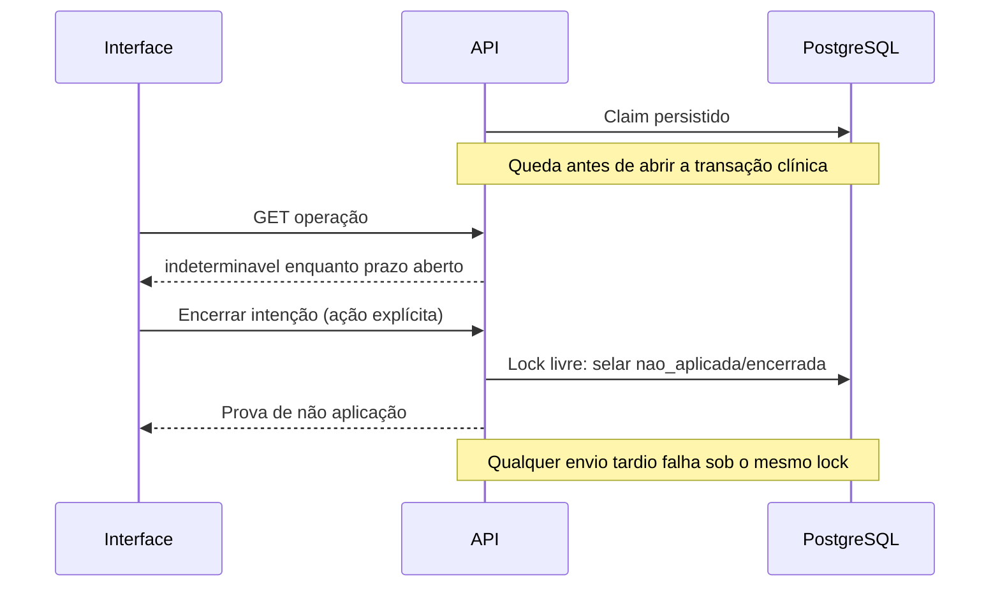

# Recuperação de operações clínicas da Etapa 7

Data inicial: 2026-10-14. Atualização técnica: 2026-10-15.

Fonte de verdade do protocolo R6D/R6B/R6B-A, adotado pela
[ADR-025](../DECISOES_ARQUITETURAIS.md#adr-025). A especificação do produto e seus
critérios individuais continuam no [roadmap](../frontend/ENTREGAS_DO_PRODUTO.md#7d-r6d).

## Decisão revisada

Em 2026-10-14, a coordenação revisou e aprovou tecnicamente o desenho antes da
implementação: intenção registrada antes do envio, uma tentativa identificada,
recibo atômico, consulta autorizada e encerramento explícito sem escrita clínica.
Esta revisão técnica não equivale ao aceite dos testes nem à revisão de
usabilidade com a equipe.

Comparação das alternativas:

| Alternativa | Limite | Decisão |
| --- | --- | --- |
| Procurar recurso em página/busca ou comparar seus valores atuais | Ausência paginada não prova rollback; valores coincidentes não identificam uma intenção | Recusada como prova |
| Reenviar POST/PUT/PATCH com a mesma chave e repetir/recuperar a resposta | Mistura verificação e execução; exige política adicional de replay dos episódios | Sem replay nesta etapa |
| Guardar recibo apenas depois do COMMIT clínico | Queda na janela entre COMMIT e recibo perde a prova | Recusada |
| Registrar intenção, assumir uma tentativa e confirmar o recibo na mesma transação clínica | Exige ledger e protocolo HTTP, mas distingue intenção, recurso e não aplicação | Adotada |

Não existe retry automático de escrita. Uma UUID nunca representa dois envios
clínicos. Nova confirmação consciente exige nova UUID quando a intenção anterior
tem prova de não aplicação, ou quando o usuário inicia outro episódio após uma
confirmação. Dois episódios intencionais com conteúdo igual continuam distintos.

## Identidade, contexto e conteúdo

`POST /v1/operacoes` recebe somente:

```json
{
  "operacaoId": "00000000-0000-4000-8000-000000000001",
  "metodo": "POST",
  "caminho": "/v1/pacientes/123/atendimentos",
  "corpoHash": "aaaaaaaaaaaaaaaaaaaaaaaaaaaaaaaaaaaaaaaaaaaaaaaaaaaaaaaaaaaaaaaa"
}
```

O exemplo é estrutural; UUID/hash reais são gerados a partir da intenção. O
usuário vem do token validado; paciente e recurso vêm da whitelist do caminho.
Todos os IDs capturados são validados como texto decimal positivo até
`9223372036854775807`, inclusive IDs de atendimentos, encaminhamentos e pendências.
Valores fora da faixa retornam 400 antes de consultar o banco.
Registro exige perfil/capacidade de escrita e vínculo atual com `pode_editar`.
Criação de paciente exige a capacidade de cadastro vigente. A confirmação da
criação liga também o novo `paciente_id` ao ledger.

`corpoHash` é SHA-256 hexadecimal minúsculo de UTF-8 do JSON canônico: executar
`JSON.parse(JSON.stringify(corpo))`, ordenar recursivamente as chaves de objetos
com o `sort()` padrão do JavaScript, preservar a ordem de arrays e serializar com
`JSON.stringify`. Assim `undefined` omitido, `null`, números e filhos representam
o mesmo corpo enviado. O hash é conferido sobre o corpo HTTP antes dos pipes de
transformação/validação. Alteração de método/caminho/hash retorna 409 sem clínica.

A escrita original recebe `X-Operacao-Id: <UUID v4>`. O servidor assume a UUID uma
só vez com um claim privado. Duplicação do registro ou envio já assumido retorna
409, sem executar o handler novamente. Clientes HTTP anteriores sem o header
continuam compatíveis; a interface usa o protocolo para oferecer recuperação.

## Respostas e ações

Registro responde 201 com `estado: "registrada"`. Consulta
`GET /v1/operacoes/:operacaoId` e encerramento explícito
`POST /v1/operacoes/:operacaoId/encerrar` respondem 200 com:

```ts
interface OperationResponse {
  operacaoId: string;
  metodo: 'POST' | 'PATCH' | 'PUT';
  caminho: string;
  corpoHash: string;
  estado: 'registrada' | 'confirmada' | 'nao_aplicada' |
    'em_curso' | 'indeterminavel';
  expiraEm: string; // instante ISO do limite para começar a clínica
  resultado?: Record<string, string | null>;
  motivo?: 'falha' | 'expirada' | 'encerrada';
}
```

| Estado observado | Prova e comportamento permitido |
| --- | --- |
| `confirmada` | O recibo foi gravado no mesmo COMMIT da clínica. Exibir confirmação e recurso; nenhum reenvio |
| `nao_aplicada` / `falha` | Após rollback, atualização condicional adquiriu o mesmo lock e comprovou ausência do COMMIT confirmado. Permite revisar e criar outra intenção |
| `nao_aplicada` / `encerrada` | Encerramento adquiriu o lock, selou o ledger e impede qualquer chegada tardia. Permite outra intenção consciente |
| `nao_aplicada` / `expirada` | Prazo vencido, lock de leitura adquirido e ausência de confirmação. Toda transação clínica futura revalida o prazo sob o mesmo lock e é recusada |
| `em_curso` | Lock de escrita ocupado. Pode haver transação em andamento; manter bloqueio e consultar novamente por ação do usuário |
| `indeterminavel` | Registro/claim existe e prazo ainda aberto, mas não há prova terminal. GET não inicia, cancela nem reaplica. Encerrar é uma ação explícita separada |

UUID ausente/desconhecida retorna 404, sem afirmar não aplicação. Falha de rede
ao registrar conserva a UUID para verificar/encerrar; não autoriza presumir que
o registro não chegou. Erro de GET, 403 ou indisponibilidade mantém a escrita
bloqueada; 401 encerra a sessão e apaga a intenção local, sem autorizar replay.
GET autorizado nunca é prova de autorização futura para escrever.

O encerramento tenta `FOR UPDATE NOWAIT`, competindo pelo mesmo registro da
transação clínica. Se ocupado, apenas informa `em_curso`; se já confirmado,
preserva o recibo. Se livre e não terminal, grava somente o estado técnico
`nao_aplicada/encerrada`. O futuro envio atrasado encontra esse estado e falha
antes de qualquer alteração clínica. Não há cancelamento implícito em GET.

## Transações e falhas

O interceptor global só ativa o contexto para o header em um dos 14 caminhos
permitidos. O contexto `AsyncLocalStorage` é consumido exatamente uma vez pela
transação clínica com `actorId` correspondente. Guardas e transações auxiliares
de leitura não consomem o contexto. Os serviços clínicos existentes continuam
responsáveis por autorização, versões, validação e composição dos filhos.

`DatabaseService` bloqueia o registro com `FOR UPDATE NOWAIT`, confere claim e
prazo usando `clock_timestamp()` sob o lock, executa a clínica e grava o recibo
permitido antes do mesmo COMMIT. Falha ao gerar/gravar recibo também reverte a
clínica. O prazo de início é de 120 segundos; uma transação iniciada antes dele
pode terminar depois enquanto conserva o lock.

GET usa `FOR SHARE NOWAIT`. O savepoint restaura a transação quando há conflito
de lock. A consulta só pode concluir expiração quando adquiriu esse lock; uma
transação clínica ativa continua `em_curso`, mesmo com prazo vencido.

```mermaid
sequenceDiagram
  participant U as Interface
  participant A as API
  participant D as PostgreSQL
  U->>A: Registrar UUID + método/caminho/hash
  A->>D: INSERT intenção registrada
  A-->>U: 201 registrada
  U->>A: Escrita + X-Operacao-Id
  A->>D: Claim único (transação técnica)
  A->>D: BEGIN; lock da intenção; validar claim/prazo
  A->>D: Clínica + filhos + recibo confirmado
  A->>D: COMMIT único
  A--xU: Resposta perdida
  U->>A: GET operação
  A->>D: Autorizar e ler com SHARE NOWAIT
  A-->>U: confirmada + IDs/versão
```

```mermaid
sequenceDiagram
  participant U as Interface
  participant A as API
  participant D as PostgreSQL
  U->>A: Escrita correlacionada
  A->>D: Claim; BEGIN; lock; alterações
  A->>D: Filho inválido; ROLLBACK
  A->>D: Transação técnica: lock + estado ainda em_curso?
  A->>D: Marcar nao_aplicada/falha
  A--xU: Resposta indisponível
  U->>A: GET operação
  A-->>U: nao_aplicada/falha
  Note over U,A: Outra intenção só após revisão e nova confirmação
```



Se a conexão falha durante COMMIT, o erro de transporte não prova rollback. A
tentativa de registrar falha ocorre em outra transação, com lock limitado e
`UPDATE ... WHERE estado='em_curso'`. Ela serializa com a transação original:
COMMIT confirmado mantém `confirmada`; rollback permite `nao_aplicada`. Se o
lock/banco não permitir comprovação, o servidor não grava conclusão e conserva
a incerteza. Queda total do processo é tratada por GET/encerramento/expiração,
sem retomar ou repetir o comando.

## Inventário exaustivo da entrega

Todos os caminhos abaixo têm prefixo `/v1`; `:id` é o paciente.

| Unidade | Método/caminho | Recibo mínimo |
| --- | --- | --- |
| R6B.1 | `POST /pacientes` | `pacienteId` |
| R6B.1 | `PATCH /pacientes/:id` | `pacienteId`, `versao` |
| R6B.2 | `POST /pacientes/:id/atendimentos` | `atendimentoId` (inclui filhos do mesmo COMMIT) |
| R6B.2 | `PATCH /pacientes/:id/atendimentos/:atendimentoId` | `atendimentoId`, `versao` |
| R6B-A.1 | `POST /pacientes/:id/tratamento-bzn` | `tratamentoId` (inclui reações da criação) |
| R6B-A.1 | `POST /pacientes/:id/retornos-bzn` | `retornoId` |
| R6B-A.3 | `PUT /pacientes/:id/projetos` | `projetoId` |
| R6B-A.3 | `PUT /pacientes/:id/notificacao` | `notificacaoId` |
| R6B-A.2 | `POST /pacientes/:id/encaminhamentos` | `encaminhamentoId` |
| R6B-A.2 | `POST /pacientes/:id/encaminhamentos/:encaminhamentoId/contrarreferencias` | `contrarreferenciaId` |
| R6B-A.2 | `POST /pacientes/:id/ocorrencias-anuais` | `eventoId` |
| R6B-A.2 | `POST /pacientes/:id/retornos-anuais` | `retornoId` |
| R6B-A.3 | `POST /pacientes/:id/pendencias` | `pendenciaId` |
| R6B-A.3 | `PATCH /pacientes/:id/pendencias/:pendenciaId` | `pendenciaId`, `status` |

IDs e versões são strings decimais; `status` admite somente o estado público.
Criação composta/POST de pendência preserva `status: null` como desconhecido;
PATCH ainda exige estado textual, portanto seu recibo não concede suporte a
voltar para null. Essa alteração depende de extensão futura do contrato.
O recibo nunca contém nome, observação, telefone, valor clínico ou cópia do
payload. PUT é comprovado por sua UUID/COMMIT, mesmo quando o novo valor coincide
com o anterior. O protocolo não altera a unicidade de BZN, a concorrência por
versão dos PATCH ou a repetibilidade dos episódios.

## Autorização, sessão e retenção

Consulta/encerramento exigem usuário funcional ativo, **mesmo `usuarioId` do
registro** e autorização corrente de leitura do paciente; administração também
não consulta UUID de outro usuário. Vínculo revogado retorna 403 sem recibo.
UUID de outro usuário retorna 404. Para criação ainda sem paciente, exige-se a
capacidade atual de cadastro. Ser o autor não substitui autorização corrente.

Rascunho, corpo e UUID ficam somente na memória da interface. Logout, 401,
expiração e troca de identidade apagam o estado local; recarregar também não
restaura intenções do armazenamento do navegador. O servidor conserva o ledger
independentemente da sessão JWT: a mesma identidade, conhecendo a UUID, pode
consultá-la em nova sessão autorizada. Não há endpoint de enumeração nem busca
por nome/hash para tentar reconstruir uma intenção perdida no navegador.

Falha temporária de identidade oculta os formulários e conserva rascunhos,
recibos e valores já confirmados da mesma identidade para a remontagem. Após
403 de escrita, revalidar o acesso permite revisar e confirmar novamente; GET de
leitura não garante permissão para salvar. Resultado incerto continua exigindo
a verificação de UUID antes de preparar outra intenção. Episódios repetíveis
usam ação explícita para outro registro/comparecimento após confirmação e
conservam o histórico de recibos da sessão.

A migration 64 acrescenta apenas o ledger técnico, seus índices e concessões
restritas à aplicação; importador/serviços de revisão não recebem acesso. Não
altera migrations aplicadas nem a evidência física de um banco anterior.
Recibos têm retenção mínima de 30 dias; esta entrega não executa purge automático.
Descarte administrativo futuro deve preservar a distinção 404/indeterminável e
nunca transformar ausência de recibo em prova de não aplicação. Logs usuais não
registram payload, hash, claim, UUID ou recibo clínico.

## Evidência

`backend/test/unit/operacoes.contract.spec.ts` verifica whitelist, canonicidade,
IDs e exclusão de conteúdo clínico. Os testes de `DatabaseService` verificam
recibo antes do COMMIT, rollback conjunto e isolamento das transações auxiliares.
`backend/test/clinical/operacoes.http.spec.ts` injeta perda de transporte no app
de teste **após** os handlers reais e COMMIT, percorre as 14 mutações e verifica
que GET/encerramento não chamam novamente os handlers nem alteram contagens
clínicas. Também cobre rollback, expiração, lock/claim concorrente, encerramento,
queda entre claim e clínica, autorização atual, outro usuário e episódios iguais.
`tests/sql/36_validar_correlacao_operacoes_clinicas.sql` cobre estrutura, estados e
privilégios com BEGIN/ROLLBACK. Resultados executados pertencem ao relatório de
validação da entrega; existência dos testes não significa aceite antecipado.
Em 2026-10-15 foram executadas regressões backend e SQL desse protocolo; os
resultados e limites estão no [relatório da Etapa 7](../validacoes/VALIDACAO_ETAPA_7.md).
Isso não declara aceite global dos fluxos nem revisão humana de usabilidade.
