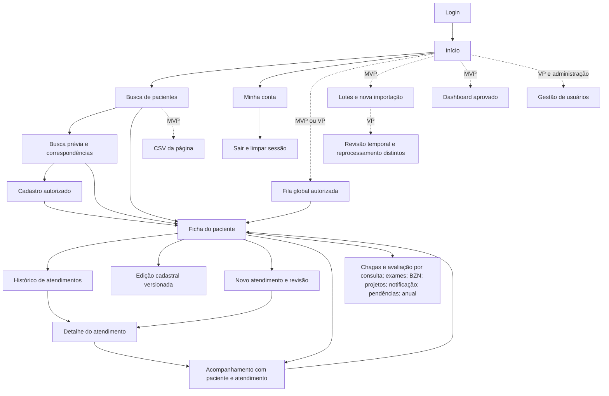
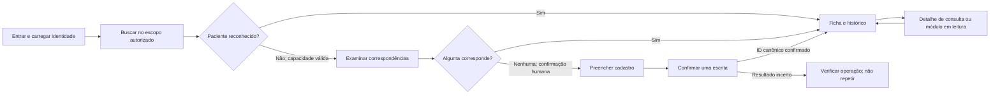
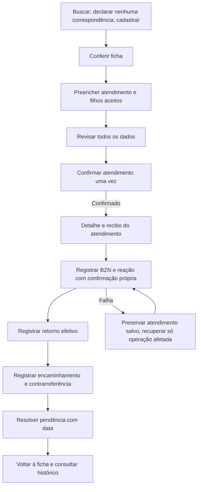
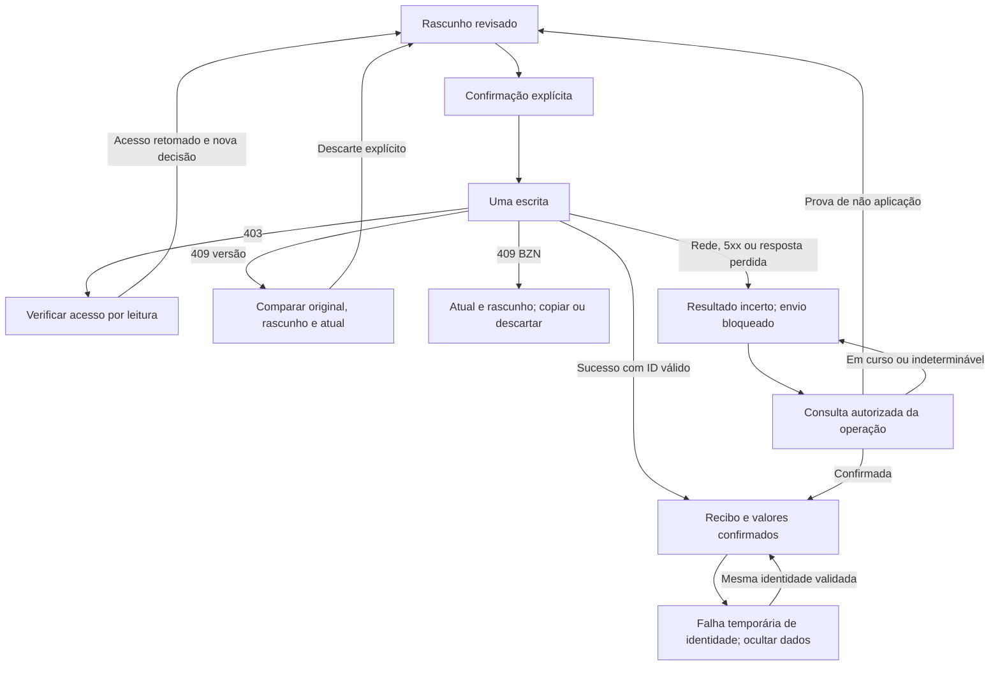
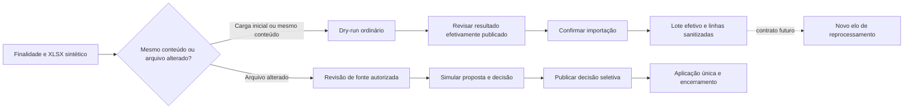
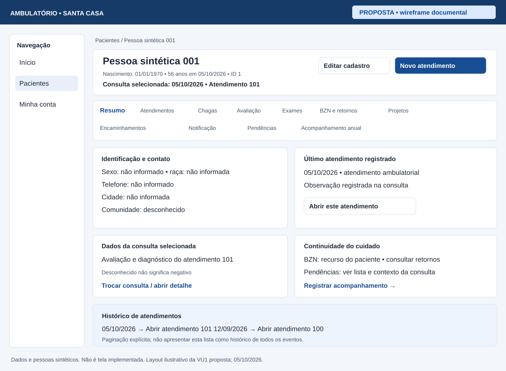
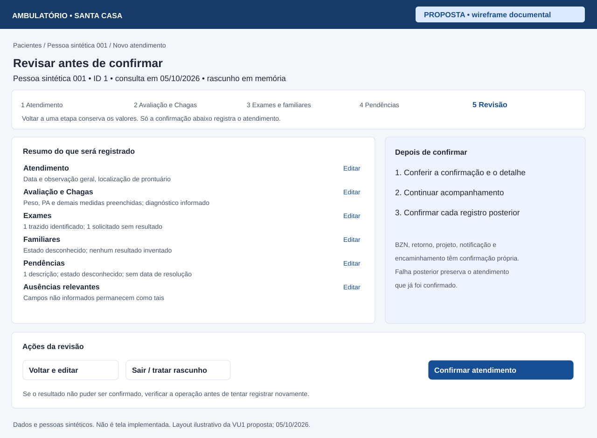
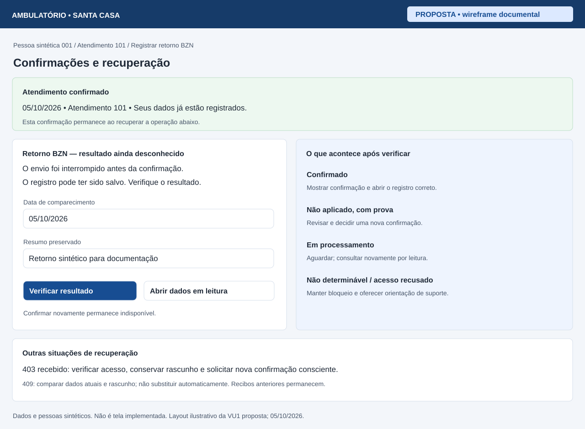

# Visão e especificação do produto frontend

Data da análise: 2026-10-05. Base: `29b3186`, branch `etapa7-commits`, árvore
limpa antes desta entrega. **Documento de produto proposto; não é aceite de
implementação nem autorização de uso real.**

Este documento é a fonte da experiência pretendida. A
[matriz ponto a ponto](MATRIZ_FIGMA_FRONTEND.md) define os requisitos de cada
elemento, sua implementação, lacuna e destino. O
[roadmap oficial](../PROXIMOS_PASSOS.md#pacotes-verificáveis-do-produto-frontend)
define a ordem e o aceite das entregas; [FRONTEND.md](../FRONTEND.md) continua
sendo a fonte do setup e do funcionamento técnico existente.

## Objetivo e fronteiras da análise

O produto organiza o trabalho do ambulatório em uma ficha longitudinal:
localizar a pessoa certa, registrar uma consulta, acompanhar o cuidado e
consultar o histórico. Importação traz dados históricos; não substitui o
cadastro e o atendimento cotidianos. O sistema registra decisões humanas,
sem interpretar sorologias, calcular indicação de BZN ou produzir diagnósticos.

Há cinco camadas de evidência, mantidas separadas nesta documentação:

| Camada | O que permite afirmar |
| --- | --- |
| Intenção original | O [texto usado no Figma Make](../../referencias/frontend/figma-make-prototipo/src/imports/pasted_text/ambulatorio-santa-casa-prototy.md) pediu fluxos e campos; nem todos foram gerados. |
| Protótipo executável | Componentes, tipos e contexto implementam navegação e mutações locais; timers, contadores e sucesso não comprovam gravação. |
| Aplicação atual | Código em `frontend/` usa contratos `/v1`; os controllers, DTOs e serviços do backend determinam suporte e persistência. |
| Produto pretendido | Propostas abaixo e na matriz, incluindo funcionalidades que precisam de novas APIs. Proposta não altera contrato vigente. |
| Validação | Relatórios anteriores e observações desta rodada comprovam somente seus cenários e ambientes. Rota existente, formulário existente e suíte aprovada não equivalem a tela aceita. |

Foram examinados todos os componentes do protótipo, `App`, `context`, `types`,
`data`, CSS e texto original; rotas, leitura, formulários, adaptadores, sessão,
cliente HTTP, rascunhos e estilos da aplicação; controllers/DTOs/autorização e
SQL de persistência dos recursos; testes de leitura/escrita e fontes abaixo.
O histórico recente contém os 13 commits de organização da Etapa 7 posteriores
a `adf2fd5`. O [relatório de 05/10](../RELATORIO_DESDE_ULTIMO_COMMIT_2026_10_05.md)
descreve alterações então locais, hoje incorporadas a `HEAD`; não representa
o status Git desta nova entrega. Nenhum código, contrato ou migration é alterado.

### Fontes e precedência

1. [Respostas clínicas vigentes](../Perguntas%20pendentes%20sobre%20campos%20e%20regras%20cl%C3%ADnicas.md)
   e [decisões D1–D12](../dados/DECISOES_HUMANAS_NOVA_PLANILHA.md) definem semântica.
2. [ADR-017–024](../DECISOES_ARQUITETURAIS.md),
   [contratos clínicos](../arquitetura/CONTRATOS_CLINICOS_ETAPA_5.md),
   [recorte 7](../arquitetura/RECORTE_CLINICO_ETAPA_7.md) e
   [catálogos](../arquitetura/CONTRATOS_CATALOGOS_ETAPA_7.md) delimitam a arquitetura.
3. Controllers, DTOs, guards e serviços em `backend/src/` comprovam o HTTP
   efetivamente publicado. Schema físico, importador e manifesto não comprovam API.
4. [Estado vigente](../ESTADO_ATUAL_DO_PROJETO.md),
   [roadmap](../PROXIMOS_PASSOS.md) e relatórios das
   [Etapas 6](../validacoes/VALIDACAO_ETAPA_6.md) e
   [7](../validacoes/VALIDACAO_ETAPA_7.md) distinguem estágio e evidência.
5. [Análise de integração anterior](../arquitetura/ANALISE_INTEGRACAO_FIGMA_MAKE.md)
   preserva a fotografia de planejamento; esta especificação e a matriz a
   sucedem para a avaliação de produto. O Figma orienta a interface, subordinado
   às fontes acima.

O dump [aplicado](../evidencias/schema_atual_ambulatorio.sql) evidencia o ambiente
persistente 00–20; incrementos 21–63 foram validados em descartáveis. Esta rodada
não consulta banco persistente nem altera a evidência estrutural.

## Pessoas, problemas e percursos

| Pessoa/perfil | Trabalho e percurso pretendido | Autorização atual e limite |
| --- | --- | --- |
| Consulta | Entrar → buscar → ficha → atendimento/módulo → histórico → sair. Conferir informação sem abrir edição. | `consulta` lê os recursos autorizados; sob `vinculo_explicito`, precisa de vínculo ativo. URL de escrita não concede permissão. |
| Profissional com edição | Buscar antes de cadastrar → identificar paciente → atendimento composto → confirmação → acompanhamento com confirmações próprias → releitura do histórico. Corrigir informações onde houver contrato. | `edicao` escreve no paciente com vínculo ativo e `pode_editar`; cadastro exige `podeCadastrar`, verdadeiro para edição somente em `todos_sinteticos`. |
| Administração | Trabalho clínico permitido e operação de lotes; posteriormente gerir identidades e acessos. Investigar falhas sem expor bruto. | Hoje administração dispensa vínculo clínico individual quando a política sintética está habilitada. Isso não define acesso institucional futuro. Não existe CRUD HTTP de usuários. |
| Responsável pela revisão de arquivos | Fonte/autorização → simulação → comparação → decisão seletiva → aplicação → encerramento. | Gestão temporal exige entitlement nominal externo, separado do perfil e do acesso à fonte. Administração não o recebe automaticamente. |

Os papéis de profissional, operador e gestor acima descrevem tarefas; não criam
novos perfis técnicos. A instituição ainda deve designar pessoas e política de
produção. O digitador legado não vira usuário autenticado automaticamente.

## Versões e destino do inventário

**VU1 — primeira versão utilizável proposta:** uso assistido exclusivamente
sintético para busca, cadastro autorizado com busca prévia realmente antecedendo
o formulário, ficha, atendimento organizado com revisão, acompanhamento já
suportado e histórico. Exige fechamento das sete lacunas, recuperação verificável
de escrita e percurso completo na interface, teclado e tela menor. A VU1 é um
recorte de uso; não substitui integralmente a planilha nem conclui o MVP oficial.

**MVP operacional do roadmap:** VU1 + complementos priorizados da Etapa 8,
produção autorizada na 9 e homologação/release na 10. CSV de página, lotes,
simulação e indicadores pequenos têm entregas próprias. Aprovar o recorte
clínico e os indicadores é condição para congelar esse marco.

**VP — visão posterior:** sorologias individuais, condição/complicações,
comorbidades, eventos/dispositivos/óbito, medicamentos, resultados detalhados,
correção de recursos existentes, upload, fila global e gestão de usuários.
Todos têm pacotes ou decisões explícitas; ausência de API é dependência de
construção, não motivo de exclusão do produto. P-01 pode promover um módulo
indispensável ao primeiro uso, com revisão das dependências antes de implementá-lo.

**EX — excluído funcionalmente:** `Localizado`, AIM3/P Digitar neste ciclo,
fusão automática, recomendações clínicas, IDs/datas/totais fictícios e sucesso
simulado. Preservação de proveniência continua. Exclusão de usuário definitiva
não integra a visão proposta. MFA/SSO e aplicação mobile nativa não são definidos
neste recorte; a interface web deve funcionar em tela menor.

A coluna **Destino** da matriz atribui VU1, MVP, VP ou EX a cada item. Não há
item implicitamente entregue porque seu grupo possui uma rota.

## Regras clínicas e de representação que a interface deve preservar

| Tema | Regra de produto |
| --- | --- |
| Identidade | Nome é obrigatório; nascimento e sexo são opcionais no contrato. Homônimos são separados. Busca limitada ao acesso/página não comprova inexistência. Nunca fundir automaticamente. |
| Idade | Derivada do nascimento pelo servidor com data de referência visível. A data fixa `2026-09-03` do protótipo não é regra. |
| Origem | Procedência de importação, contexto da consulta e diagnóstico são conceitos distintos. Não classificar pessoa como portadora só pela origem. Código de negócio e projeção de proveniência aguardam P-05. |
| Contexto do atendimento | Dois indicadores anuláveis, conforme DTO e constraints existentes; não reduzir todos os estados legados ao rádio exclusivo do Figma. Validar combinações aceitas no servidor, sem nova regra clínica. |
| Chagas | Descoberta por autorrelato é quando a pessoa descobriu a doença; não é data do resultado nem confirmação laboratorial. Mostrar snapshots por atendimento. |
| Familiares | Indicador triestado e pares identificação/resultado; não exigir data de exame ou cadastro civil. Rastreio não é histórico de doença familiar. Todos os filhos devem ser alcançáveis. |
| Exames | Identificar cada trazido/solicitado, sobretudo categorias genéricas. Solicitação não exige resultado ou realização. Sorologia não é convertida em exame genérico. |
| BZN | Tratamento canônico único por paciente; indicação, início, uso pelo ambulatório e reação independentes. Duração em dias e ano aproximado não são datas fabricadas. |
| Retornos | Comparecimento real, completo e não futuro, ligado ao atendimento; 30 dias/final BZN não são prescrição + 30/60. Vários episódios preservam história. Ano isolado não cria visita. |
| Projetos/notificação | Recursos do paciente, com estados/textos independentes. Ocultar número/justificativa conforme indicador não pode apagar preenchimento ou legado. |
| Pendências | Texto livre separado de observação clínica; sem taxonomia inferida. Na criação, omissão do status cria `aberta`; `null` é desconhecido e `nao_informado` é valor textual distinto. Resolução exige data explícita. |
| Contrarreferência | Episódios múltiplos do encaminhamento; não tratar como opção equivalente de tipo de encaminhamento. Upload não é comprovado pela existência de retorno. |
| Dados técnicos | IDs/versões bigint como texto; NUMERIC preserva precisão; datas civis não mudam de dia pelo fuso. ID técnico é informação secundária, sem gerar código fictício. |

Os avisos antigos do Figma sobre idade, autorrelato, exames, retornos,
contrarreferências e pendência/observação não devem reaparecer como indefinições
clínicas já resolvidas. D9 (planejamento/desfecho) e representação documental
avançada de D10 permanecem pendentes; ver P-06/P-07.

## Interface pretendida, tela por tela

Cada família abaixo corresponde às linhas da matriz; `RQ-<ID do elemento>` é o
requisito individual definido pelo comportamento e aceite dessa linha.

### Login e sessão — LOG

Marca discreta, título de acesso, Login e Senha com rótulos associados, Entrar e
mensagem próxima ao formulário. Autocomplete correto, senha nunca reapresentada,
Enter envia uma vez. Usar autenticação real e carregar `/auth/me`; restaurar
destino protegido válido, incluindo paciente, aba e filtros. Campos obrigatórios,
carregamento, erro de credenciais, sessão expirada e limite de tentativas são
estados diferentes. Inativo e credencial inválida têm resposta uniforme no
contrato; não reproduzir enumeração local do protótipo. Não exibir credenciais
demonstrativas no produto. Minha conta usa identidade do servidor.

### Layout e navegação — NAV

Desktop: marca e navegação à esquerda, identidade/perfil no cabeçalho, breadcrumbs
e conteúdo principal. Na VU1: Início, Pacientes e Minha conta; ações clínicas no
contexto da ficha/atendimento. Pendências, Importações, Dashboard e Usuários
entram quando suas entregas e permissões estiverem aceitas. Não oferecer rota
decorativa que anuncie um fluxo funcional inexistente.

Navegação é URL real, links diretos, voltar/avançar, aba e paginação recuperáveis.
O retorno à busca deve preservar filtros/página; os breadcrumbs atuais para
`/pacientes` ainda não guardam esse retorno. Em tela menor, menu compacto
expansível e conteúdo em uma coluna; a sidebar não pode consumir a área da ficha.
Menu de conta acessível e saída explícita. Logout/401/expiração/troca de perfil ou
identidade encerram dados e rascunhos da sessão conforme ADR-024.

### Início — HOM

VU1: buscar paciente, cadastro condicionado à capacidade, iniciar atendimento
depois de escolher a pessoa e retomar histórico. Ações com verbo e consequência
claros; sem contadores de páginas apresentados como população total. MVP:
quatro indicadores aprovados, atendimentos/pendências recentes autorizados e
atalhos à fila/lotes. Atalho de atendimento recente abre aquele atendimento;
Revisar abre o item, não apenas uma lista sem seleção. Definições e escopo vêm
da mesma API agregada usada pelo dashboard, com instante de atualização.

### Pacientes e busca — LIS

Busca em destaque, filtros rotulados, Buscar/Limpar, resultado e paginação. VU1
usa nome/sexo e ID/nome; ID secundário, Ver ficha explícito, cadastrar após
capacidade confirmada. Resultado vazio significa vazio desta página/escopo.
VP acrescenta nascimento, código e origem com semântica definida, último
atendimento e projetos por projeção própria do backend, sem uma chamada por linha.
Editar deve abrir edição real, Novo atendimento deve preservar paciente; ambos
condicionados à operação autorizada. CSV de MVP informa filtros e página.

### Verificação antes do cadastro e edição de paciente — CAD

Proposta de três passos: **buscar → examinar correspondências → cadastrar**.
Formulário só aparece após busca respondida e declaração explícita de que nenhum
resultado corresponde; se houver erro não liberar por ausência de resultados.
Nas capacidades atuais, buscar nome e abrir ficha para conferir nascimento;
busca por nascimento depende de contrato posterior. Possíveis homônimos não
bloqueiam permanentemente cadastro legítimo nem produzem merge.

Formulário em Identificação, Comunidade, Contatos e Endereço. Nome obrigatório;
nascimento/sexo/raça e comunidade conforme opcionalidade vigente. Tipo de
comunidade não deve converter desconhecido em Não. Idade é informativa após
consulta. Adicionar/remover **novos** telefones não remove contatos persistidos;
edição de endereço gera snapshot e mantém campos omitidos. Origem informativa
não é rádio para inventar diagnóstico. Salvar confirma ID canônico e abre ficha;
Cancelar/voltar passa pela decisão de rascunho, sem descartar silenciosamente.
PATCH envia versão original e somente alterações, com comparação em 409.

### Ficha longitudinal — FIC, RES, HIS, CHA, PRO, EXA, TRA, AVL, ENC, NOT

Cabeçalho: nome, nascimento, idade/referência, identificador secundário e ações
pertinentes. Proposta VU1: Resumo, Atendimentos, Chagas, Avaliação, Exames,
BZN e retornos, Projetos, Encaminhamentos, Notificação, Pendências e
Acompanhamento anual. Sorologias e medicamentos acrescentam conteúdo às áreas
clínicas quando publicados; não criar aba por tabela SQL.

Resumo mostra identificação/contato e **último atendimento registrado**, com
link e data. Um painel clínico de uma consulta sempre identifica a consulta;
não escolher silenciosamente o último valor não nulo de vários atendimentos.
Diagnóstico/avaliação em VU1 podem seguir um seletor de atendimento e ler seu
detalhe. BZN/notificação são do paciente. Projetos, exames e pendências carregam
por recurso, com paginação e limites visíveis. Timeline integrada de exames e
projetos requer projeção temporal própria; a primeira timeline pode ser apenas
de atendimentos, nomeada assim.

Histórico: data/contexto, procedência quando houver contrato, observação e link
para detalhe. Nunca apresentar status “Completo” sem definição aprovada. Exames
agrupados por trazido/solicitado preservam identificação, resultado e observações;
status/data de exame e parâmetros detalhados aguardam evolução HTTP. Expansão
mostra detalhe sem perder aba ou página. Vazio não significa resultado negativo.

Cada aba deve ter carregamento, vazio específico, erro e recuperação de leitura.
Reconsulta oculta conteúdo anterior enquanto revalida autorização. Confirmação
de escrita deve estar disponível ao voltar à ficha na mesma sessão. Rota direta
e histórico do navegador precisam manter contexto, inclusive seleção de
contrarreferência. Correções de recursos existentes só aparecem após contrato
próprio; criar outro registro não é correção.

### Atendimento novo, revisão e detalhe — ATD, DIA, CON, COM, MED, EVT, PRJ, EXN, BZN, ECR, NTF, OBS

VU1: cabeçalho visível com pessoa e intenção, etapas **Atendimento → Avaliação e
Chagas → Exames e familiares → Pendências → Revisão**. Não são os doze módulos
completos do protótipo. Cada etapa conserva valores em memória; a revisão mostra
todos os campos preenchidos, ausências relevantes e quantidades/identificações
dos filhos, com Voltar e editar e Confirmar atendimento. Só validar formatos e
invariantes existentes; nenhum score. Em mobile, etapa atual/total e controle
anterior/próxima acima das ações finais. Erro leva ao campo/etapa correspondente.

O primeiro POST grava núcleo, avaliação, diagnóstico, exames, rastreio e
pendências numa transação. Não incluir BZN/projeto/notificação/encaminhamento
nesse payload. Após confirmar, mostrar recibo do atendimento e **Continuar
acompanhamento**. Cada operação posterior tem resultado próprio e não desfaz
a consulta anterior. Essa fronteira deve ser compreensível sem citar endpoints
ou transações na tela.

VP integra condição/complicações, comorbidades, eventos/dispositivos/óbito,
medicamentos e sorologias em seções progressivas, quando tiverem destino público.
A revisão deve impedir perda de valores condicionais. No protótipo condição,
sintomas, AVC/dispositivos/óbito são preenchíveis e descartados; isso é defeito
da referência, não decisão de produto a adotar.

Detalhe consolidado mostra dados daquele atendimento, filhos paginados e vínculo
ao paciente. Editar atendimento atual significa somente núcleo versionado; não
anunciar edição de diagnóstico/exames/familiares. Atalhos levam `atendimentoId`,
inclusive ao atravessar BZN/retornos e encaminhamentos. Retorno ao histórico
preserva página e seleção. Familiares de cada snapshot têm paginação própria.

### Acompanhamento — ACO

Uma operação por formulário: tratamento BZN, retorno BZN, participação em projeto,
notificação, encaminhamento, contrarreferência, retorno anual, ano informado,
pendência. Mostrar paciente e atendimento de registro quando aplicável; projeto
e notificação pertencem ao paciente. Se houver contexto vindo do detalhe,
pré-selecioná-lo e permitir mudança consciente para outro atendimento da pessoa.
Catálogos e seletores paginam; ausência numa página não significa inexistência.

BZN: indicação/motivo, início/motivo, ambulatório, duração, ano, prescrição,
reação e observações independentes; lista de reações com descrição/data/
gravidade/consequência/observação em texto. Um concorrente que cria BZN não pode
tornar o rascunho anterior inacessível: mostrar tratamento atual e rascunho com
copiar/descarte explícitos, sem transformar POST em PATCH. Correção e reação
isolada vêm em entregas posteriores.

Retornos: tipo quando BZN, atendimento, data de comparecimento e resumo.
Novo episódio somente após intenção anterior reconciliada/confirmada. Projetos:
seleção por catálogo e participa/pendência/falha/textos; notificação:
indicador/número/justificativa/observação. PUT atuais não possuem versão:
pré-carga e patch parcial de campos reduzem perda, mas não detectam toda edição
concorrente. Controle explícito de concorrência é proposta com pacote próprio.

Encaminhamento: atendimento, tipo/projeto ativos opcionais, origem,
destino/serviço/especialidade, três datas, status/prioridade, documento,
motivo/conduta/observação. Contrarreferência seleciona encaminhamento e registra
episódio com data/status/resumo/conduta/observação; upload é posterior. Pendência
nova: atendimento, descrição, estado e datas. Revisar existente: descrição em
leitura, status/data; observação/responsável de revisão ainda precisam de API.

### Pendências por paciente e fila global — PEN

VU1: lista no contexto da pessoa/atendimento e ações de criação/resolução/
reabertura com data explícita. Diferenciar desconhecido de `nao_informado`.
MVP/VP: fila autorizada com filtros status/origem/período, contadores agregados,
tabela com descrição/contexto/data e Abrir revisão. Não construir fila percorrendo
todos os pacientes. Revisão mostra fato atual, origem sanitizada, informação
sem interpretação segura e decisão humana; novo registro de revisão deve ser
auditável. Fila de inconsistência de importação e pendência assistencial não
são automaticamente o mesmo recurso. P-04 define esse agrupamento.

### Importações e revisão de arquivos — IMP

Histórico autorizado → detalhe de lote/linhas/erros sanitizados → nova importação.
Seleção real de XLSX, finalidade explícita (`carga_inicial` ou `mesmo_conteudo`),
código solicitado, simulação, leitura do resultado, confirmação e lote efetivo.
Até um contrato de relatório rico existir, dry-run atual só confirma execução
sem gravação; não inventar contagens por timers. Preservar arquivo/seleção dentro
da sessão se a leitura falhar, respeitando a política de dados.

Detalhe atual não publica nome/hash/versões técnicas completas ou paciente
conciliado da linha. Evoluir projeção sanitizada justificadamente; não expor
JSON bruto. Status, contagens e código de erro vêm do servidor. Progresso sem
percentual inventado. Reenvio do mesmo conteúdo apresenta o lote efetivo, não
anuncia nova execução. **Criar reprocessamento** encadeado é capacidade futura
distinta, hoje só CLI; arquivo alterado usa revisão temporal própria, nunca o
POST ordinário. Telas de revisão precisam de consulta/capacidades públicas para
retomada, além dos POST existentes. Não inferir entitlement por perfil.

### Dashboard e CSV — DAS

MVP: KPIs pequenos aprovados com definição, população autorizada, período e
referência temporal explícitos. Gráfico de atendimentos por período e tabela
acessível equivalente. VP: origem/projetos após semântica e contagens aprovadas;
projetos podem sobrepor pacientes, portanto soma não é população única.
Não calcular totais percorrendo páginas clínicas nem apresentar ausência como 0
quando a API falhou. Filtro de período só afeta indicadores definidos como tais.

CSV disponível hoje é ID/nome **da página e filtros** autorizados aos três
perfis. Proposta MVP coloca essa exportação na busca, com confirmação de escopo,
download real e neutralização de fórmulas; não chama o arquivo de relatório do
dashboard. Exportação ampliada de métricas/colunas é P-05 e contrato futuro.

### Usuários, minha conta e erros — USR, CTA, ERR

VP de usuários: listagem paginada nome/login/perfil/status, seleção de perfil e
confirmação de ativação/inativação. Sem autoalterar perfil, exclusão definitiva
ou vincular digitador antigo. Exige API, concorrência, auditoria e política para
evitar perda do último administrador; não substituir por gestão de vínculo
clínico já existente. Proposta P-08, sem implementação administrativa atual.

Minha conta VU1: nome/perfil e identificação secundária de `/auth/me`, sair e
orientação institucional de suporte. Login/status entram apenas após extensão
de identidade, sem derivar “ativo” de dados locais.

401 encerra sessão e reautentica; 403 mostra recusa e opção de verificar acesso;
404 oferece destino útil sem afirmar que o paciente foi removido; 429 informa
aguardar; 503/rede permitem nova **leitura**; erro de escrita usa recuperação
abaixo. Página desconhecida permite início/busca. Não mostrar SQL, stack, tokens
ou texto arbitrário de processamento.

## Estados, salvamento e recuperação — EST

| Estado/situação | Comportamento e condição observável de saída |
| --- | --- |
| Carregamento/reconsulta | Informação anterior oculta; leitura cancelável; ação de escrita desabilitada enquanto identidade/recurso não for revalidado. |
| Vazio | Mensagem específica do recurso e da página/escopo; não concluir ausência global, resultado negativo ou contagem zero indiscriminadamente. |
| Erro de entrada/400 | Rascunho visível, erro associado ao campo e resumo com foco; corrigir e confirmar uma intenção. Não repetir a escrita por timer. |
| Pronto/rascunho | Valores, baseline e identidade/contexto em memória; mudança de etapa não perde dados. Navegar pede continuar ou sair mantendo rascunho. Descarte é explícito por rascunho. |
| Enviando | Um envio; duplo clique/Enter/navegação não duplicam. Mostrar aguardar confirmação. Não tornar POST idempotente apenas por desabilitar botão. |
| Confirmado | Recibo com recurso/ID, paciente, atendimento quando aplicável e valores confirmados; releitura por ação. Permanece após falha temporária de `/auth/me` da mesma identidade. |
| 403 com recusa conhecida | Preservar rascunho ocultando dados quando acesso clínico faltar; verificar identidade/acesso por leitura. Leitura autorizada não comprova permissão de escrita. Oferecer nova confirmação consciente, com servidor revalidando a escrita, sem envio automático. |
| 409 versionado | Original, rascunho e atual comparáveis; nenhum rebase. Descartar somente rascunho afetado para iniciar edição com versão nova; revisão manual antes de novo PATCH. |
| 409 de unicidade BZN | Tratamento atual e rascunho acessíveis, copiar/descarte; não recriar tratamento nem aplicar dados como correção por conta própria. |
| Resposta perdida/5xx/cancelamento/resposta inválida | Resultado **incerto**, nunca “não salvo”. Bloquear repetição da intenção. Verificar estado pelo protocolo proposto; GET de página vazia não prova rollback. |
| Identidade temporariamente indisponível | Ocultar clínica; conservar rascunhos e recibos no mesmo escopo de identidade, recuperar por leitura. Se escrita foi interrompida, continuar incerta. |
| 401, expiração, logout ou identidade/perfil diferente | Limpar clínica e rascunhos/recibos dessa sessão. Não transportar valores para a identidade seguinte. Recarregar perde memória com aviso. Recuperação entre sessões precisa de consulta autorizada no servidor. |

### Verificação de resultado sem repetição de escrita

Proposta P-02 e pacotes 7D-R6D/B/U e R6B-A/R6U-A: correlacionar uma intenção com resultado
autorizado no servidor, com identidade, recurso e resumo de payload suficientes
para distinguir **confirmado**, **comprovadamente não aplicado**, **ainda em
processamento** e **não determinável**. Não publicar aqui um contrato já aprovado.
Uma resposta que confirma gravação permite abrir o recurso e arquivar o recibo;
uma prova de não aplicação permite preparar nova intenção e nova confirmação;
processamento/incerteza mantêm bloqueio e encaminhamento de suporte.

O fluxo de verificação faz apenas leitura, nunca reaplica POST/PATCH/PUT. Repetir
busca/consultar primeira página não estabelece ausência, especialmente para
episódios repetíveis, homônimos ou vínculo revogado. Sem essa prova a recuperação
é parcial; não chamar o bloqueio permanente de fluxo concluído. Idempotência
ou registro de operações, se escolhidos, devem ter desenho próprio, autorização,
retenção e validação. Nova estrutura só por migration incremental futura.

## Acessibilidade e telas menores

Requisitos de todas as famílias: rótulos e mensagens associados; grupos com
legenda; foco visível e ordem previsível; operação por teclado; nenhum clique
somente em linha/card; status por texto além da cor; erro/sucesso anunciados.
Menus e diálogos têm nome acessível, Escape, contenção/restauração de foco e
ações alcançáveis em zoom. Não copiar os modais do protótipo sem esses controles.

Verificar 390 px e 320 px, zoom 200%, tabelas em contêiner próprio e ações
principais sem rolagem horizontal da página. Formulários em uma coluna e resumo
de etapas acessível. Captura a 390 px desta rodada não comprova toda a
acessibilidade; Axe e revisão humana da entrega continuam necessários.

## Mapas e percursos propostos

### Mapa de navegação

Linhas contínuas representam VU1 proposta; pontilhadas indicam capacidades
posteriores e dependências, não menus já implementados. URLs propostas para
novas abas/áreas não são contratos atuais.

### Consulta e cadastro com decisão humana

### Percurso completo que precisa ser comprovado na interface

Este é o cenário de 7D-A1. Dados do paciente e atendimento são criados por
ações de tela; helpers/API só preparam identidades, permissões e catálogos.

### Recuperação da escrita e reconciliação

### Operação de importação

## Capturas, wireframes e limites de inspeção

O [caderno visual](visuais/README.md) contém pares desktop/móvel e anotações
ligadas aos IDs da matriz. Foram usados Chromium headless, 1440×960 e 390×844,
locale pt-BR/fuso São Paulo. Protótipo executado de cópia temporária com lockfile;
frontend servido por Vite sem alterar fonte. As prévias 8443/4176/6061 não estavam
ativas inicialmente. A aplicação foi inspecionada com **todas as requisições
`/v1` interceptadas por fixture sintética**, sem API/PostgreSQL reais, sem
migrations. Fontes remotas do protótipo foram bloqueadas; fallback local pode
alterar a tipografia. Capturas são da viewport, não inventário completo por imagem.

Os três wireframes são **propostas**, não telas implementadas nem imagens
exportadas do Figma. Demonstram hierarquia, fronteiras de salvamento e recuperação.

Nesta rodada, o navegador confirmou abas da ficha do Figma, editar paciente sem
ação, etapas/revisão, fila/modal, importação simulada, dashboard/usuários, listagem/
ficha/formulário atuais e três lacunas R7. Em 390 px ambos os `body.scrollWidth`
mediram 390; ainda assim a captura do Figma mostra a sidebar fixa ocupando
quase toda a área útil e conteúdo cortado. Largura do body não comprova usabilidade.
Demais campos/transições foram avaliados estaticamente; ausência de observação
no navegador é explicitada na matriz. Não houve nova execução E2E real.

## Reavaliação das sete lacunas e cobertura de validação

| Lacuna | Conclusão pelo código em `29b3186` e evidência desta rodada | Destino de correção |
| --- | --- | --- |
| R7-01 | Aberta: `PacientesService.attendance` aplica o mesmo offset a snapshots e familiares e só associa resultados aos snapshots da página. Um snapshot com 30 familiares perde acesso aos últimos 10. Análise estática, sem nova reprodução SQL. | 7B-R1B/U, contrato de paginação independente. |
| R7-02 | Aberta: `MutationForm` bloqueia `denied` sem ação de retomada. Navegador interceptado: depois de 403 e foco com leituras restauradas, Salvar permanece desabilitado; uma escrita observada. | 7D-R2. |
| R7-03 | Aberta: `uncertain` continua bloqueado; link de consulta não reconcilia intenção. GET paginado não prova não aplicação. Código e teste de perda de resposta cobrem contenção, não conclusão da recuperação. | 7D-R6D/B/U e R6B-A/R6U-A, por classe de operação. |
| R7-04 | Aberta, com precisão adicional: criação composta e POST posterior aceitam `null`; formulários impedem representá-lo. **PATCH atual não aceita `null`**, pois `PendingUpdateDto.status` tem `IsIn` sem opcionalidade. Não atribuir esse suporte ao PATCH. | 7B-R2 (criações); 7C-R2B/U (correção para desconhecido proposta). |
| R7-05 | Aberta parcialmente: `ClinicalActions` já inclui `atendimentoId`; o atalho principal de `AttendancePage` o omite, assim como os atalhos BZN ↔ retorno em `FollowupBzn`. Navegador confirmou href `/pacientes/1/registrar?tipo=bzn`. | 7D-R1, testar todos os caminhos, preservando o que já funciona. |
| R7-06 | Aberta: GET de BZN existente substitui o formulário e oculta rascunho após conflito; proteção de recarga não o torna recuperável. Análise estática. | 7D-R5. |
| R7-07 | Aberta: estado do recibo/valores fica em `useState`, embora estado de escrita esteja no store. `identityError` desmonta Outlet; mesma identidade recuperada perdeu recibo e data. Navegador interceptado: recibo 0, data vazia, somente duas escritas intencionais na sessão de inspeção. | 7D-R4. |

| Evidência existente | Requisitos que sustenta | O que ainda não comprova |
| --- | --- | --- |
| Etapa 6 e `clinical.spec.ts` | Login, sessão, leitura autorizada, filtros/URL, paginação publicada, IDs/datas, teclado/Axe nos cenários descritos. | Ficha visual pretendida completa, módulos sem API, fila/dashboard/gestão, escrita. |
| `stage7.spec.ts`, testes 7A/7B | Cadastro, preservação de contatos/endereço, PATCH original/409, criação composta/rollback, campos exercitados. | Busca obrigatoriamente antecedendo cadastro, todos os campos individualmente, familiares além da primeira página. |
| Testes 7C de BZN/comunicação | Tratamento único, reações na criação, episódios, projetos/notificação/encaminhamento/contrarreferência e resolução com data nos casos exercitados. | Criação do paciente/consulta na mesma sequência de UI; edição independente; recuperação integral de concorrência. |
| Testes 7D de perda de resposta | Sem reenvio automático, consulta do registro commitado, intenção bloqueada ao voltar, ocultação por revalidação e 401 nos cenários descritos. | Reconciliar/encerrar intenção incerta, retomada pós-403, recibo após falha posterior à confirmação. |
| Capturas/observações desta rodada | Composição visual, rotas/links e defeitos reproduzidos com respostas sintéticas. | Persistência, rollback, guards e autorização reais, integração com PostgreSQL ou aceite da equipe. |

Os 106 unitários e 30 cenários Chromium/API/PostgreSQL registrados em 04/10
permanecem evidência histórica dos cenários executados. Não foram repetidos em
uma mudança documental. CI remota e revisão com a equipe continuam pendentes.

## Decisões de produto ainda pendentes

São propostas abertas, não decisões clínicas novas ou mudanças aprovadas de
contrato. Pacotes dependentes permanecem planejados até a escolha necessária.

| ID | Proposta e decisão solicitada | Impacto no roadmap |
| --- | --- | --- |
| P-01 | Aprovar VU1 restrita aos contratos clínicos atuais recuperados; indicar quais módulos adicionais são indispensáveis para substituir a planilha no primeiro uso. | Define promoção de pacotes 7B-E/7C-E e congelamento do MVP; ausência de API continua trabalho necessário. |
| P-02 | Aprovar desenho de recuperação por correlação de operação consultável, inclusive após nova sessão. Alternativa de reenvio cego não atende o produto. | 7D-R6D escolhe solução técnica e eventual idempotência/registro, sem alterar nada nesta análise. |
| P-03 | Adotar etapas/revisão e confirmação separada do acompanhamento; tornar versão/concorrência explícita nos PUT de projeto/notificação e revisão de pendência. | 7D-U1/U2 e 7C-E4B/U; controles atuais não detectam toda concorrência. |
| P-04 | Definir se fila global agrupa pendências assistenciais e inconsistências de importação ou as apresenta em grupos relacionados; definir responsabilidade e registro de decisão. | 8A2D/B/U, 8A3B/U. Não classificar texto automaticamente. |
| P-05 | Priorizar filtros/colunas/código e procedência; aprovar KPIs, população/período e exportação ampliada. Proposta inicial: nome/sexo, ID secundário e CSV da página. | 8A1, 8B1D/B/U, 8B2B/U, 8B3D/B/U. API sintética atual de CSV permite três perfis, Figma restringe a admin. |
| P-06 | Confirmar destino de D9: planejamento de retorno futuro/desfecho e eventual retirada do campo legado. Proposta: separado de comparecimento efetivo. | 7C-E5D/B/U. Não fabricar retorno, excluir texto ou consolidar silenciosamente. |
| P-07 | Priorizar upload de contrarreferência e decidir documento/estado/armazenamento/retenção e acesso. | 8C3D/B/U; permanece posterior salvo promoção explícita. |
| P-08 | Priorizar gestão de usuários e aprovar política institucional de identidade/acesso; definir proteção do último administrador, suporte e dados de Minha conta. | 8D1D/B/U, 8D2B/U, Etapas 9B/9D. Não presumir acesso irrestrito real por perfil. |
| P-09 | Aprovar reprocessamento encadeado na interface e prioridade da revisão entre arquivos alterados; definir leitura e retomada desses processos. | 8C4D/B/U e 8C5B/U; reenvio ordinário é outra ação. |

## Conclusão documental e condição de aceite do produto

Esta documentação termina quando todo ID da matriz tem avaliação/destino,
requisito ligado a pacote ou decisão, fluxo compreensível e entregas verificáveis;
links, representações e diff são conferidos. Isso não encerra a Etapa 7.
Cada pacote de implementação só termina com evidência vinculada aos IDs que
realmente exercitou, casos de falha pertinentes e aceite registrado. Bloqueio por
contrato/decisão deve ser identificado; validação parcial não vira conclusão.
