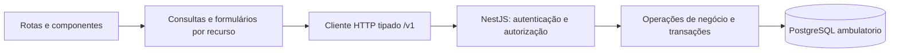

# Análise do Figma Make e planejamento da integração do frontend

> Documento histórico. Preserva a fotografia indicada pela data; não substitui
> o [estado vigente](../ESTADO_ATUAL_DO_PROJETO.md) nem o [roadmap](../PROXIMOS_PASSOS.md).

Data: 2026-10-03. Status: avaliação e planejamento concluídos; implementação do
frontend não iniciada. A análise é estática, sobre o código disponibilizado em
`referencias/frontend/figma-make-prototipo/`; não representa homologação visual
no navegador.

Esta fotografia preserva a avaliação estática de 2026-10-03. A implementação
posterior da Etapa 6 está descrita em [FRONTEND.md](../FRONTEND.md), com estágio
vigente em [ESTADO_ATUAL_DO_PROJETO.md](../ESTADO_ATUAL_DO_PROJETO.md) e evidências
no [relatório de validação](../validacoes/VALIDACAO_ETAPA_6.md).
A evolução dos formulários da Etapa 7 está no
[recorte clínico vigente](../arquitetura/RECORTE_CLINICO_ETAPA_7.md) e no
[contrato dos catálogos ativos](../arquitetura/CONTRATOS_CATALOGOS_ETAPA_7.md). As lacunas da
matriz abaixo preservam a fotografia anterior à implementação.
As provas de execução pertencem ao
[relatório da Etapa 7](../validacoes/VALIDACAO_ETAPA_7.md).

Em 2026-10-05, a [visão e especificação de produto](../frontend/VISAO_E_ESPECIFICACAO.md)
e a [matriz ponto a ponto](../frontend/MATRIZ_FIGMA_FRONTEND.md) reavaliaram o
protótipo, frontend e backend atuais, com observações no navegador delimitadas.
Elas são as fontes vigentes do inventário/destino e da experiência pretendida;
este documento preserva a fotografia histórica. A sequência vigente está nos
[pacotes do roadmap](../frontend/ENTREGAS_DO_PRODUTO.md#pacotes-verificáveis-do-produto-frontend).

## Objetivo, limites e fontes

Aproveitar a identidade visual, a organização da ficha e os fluxos úteis do
protótipo para desenvolver o frontend do sistema existente. A integração deve
seguir os contratos e as regras clínicas vigentes. A reprodução integral do
protótipo não é critério de aceite.

Esta avaliação não altera código executável, dependências, banco, migrations,
contratos HTTP ou regras de negócio. O diretório do protótipo já estava presente
e não versionado no início da análise. Foi realocado integralmente para a área de
[materiais de referência](../../referencias/README.md), com conteúdo preservado,
fora da futura aplicação e sem dependência de build ou implantação.

Fontes de verdade:

- [Estado atual](../ESTADO_ATUAL_DO_PROJETO.md) e
  [roadmap](../PROXIMOS_PASSOS.md): estágio e escopo das Etapas 6–8.
- [Respostas clínicas](../dados/DECISOES_HUMANAS_NOVA_PLANILHA.md#respostas-clínicas-originais-de-28092026),
  [decisões humanas](../dados/DECISOES_HUMANAS_NOVA_PLANILHA.md) e
  [contratos clínicos](../arquitetura/CONTRATOS_CLINICOS_ETAPA_5.md): significado dos dados.
- [Arquitetura do backend](../ARQUITETURA_BACKEND.md),
  [ADRs](../DECISOES_ARQUITETURAIS.md) e controllers/DTOs/services em
  [`backend/src/`](../../backend/src): contrato executável e autorização.
- [Modelo físico](../MODELO_FISICO_ATUAL.md) e
  [dump aplicado](../evidencias/schema_atual_ambulatorio.sql): estrutura
  persistente, distinta das migrations validadas em bancos descartáveis.
- [`App.tsx`](../../referencias/frontend/figma-make-prototipo/src/App.tsx),
  [`context.tsx`](../../referencias/frontend/figma-make-prototipo/src/context.tsx),
  [`types.ts`](../../referencias/frontend/figma-make-prototipo/src/types.ts),
  componentes e CSS do protótipo: referência da interface efetivamente gerada.

O [texto usado no Figma Make](../../referencias/frontend/figma-make-prototipo/src/imports/pasted_text/ambulatorio-santa-casa-prototy.md)
registra intenções de produto, mas alguns fluxos pedidos não foram implementados
no código gerado. Suas questões clínicas abertas também não substituem decisões
posteriores do projeto. Trechos históricos de documentos temáticos devem ser
lidos com o estado vigente e a [matriz de aceite da Etapa 5](../validacoes/ACEITE_INTEGRADO_ETAPA_5.md).

Critérios de aceite desta avaliação: inventariar telas e interações; relacionar
cada fluxo ao suporte HTTP ou à lacuna concreta; classificar o reaproveitamento;
definir fronteiras, sequência, pendências e validação da implementação futura.

## Estrutura atual e condições de integração

| Área | Situação observada | Consequência para o frontend |
| --- | --- | --- |
| PostgreSQL / `sql/` | Schema `ambulatorio`; evidência persistente com 38 tabelas até migration 20. Incrementos da Etapa 5 validados em descartáveis até 63. | Preparar ambiente sintético compatível antes de testar recursos novos; não apontar a interface automaticamente ao banco persistente nem executar migrations no startup. |
| Importador / `scripts/` / `manifestos/` | Importador Python, manifesto versionado, finalidade explícita, proveniência, idempotência e revisão temporal separada. | Consumir portas HTTP existentes; nenhuma transformação clínica ou conciliação deve migrar para o navegador. |
| `backend/` | Monólito modular NestJS/TypeScript, `pg`, DTOs explícitos, SQL parametrizado, transações e versões de registro. | Preservar módulos e operações de negócio; frontend não acessa PostgreSQL nem tabelas brutas. |
| HTTP e identidade | Contrato `/v1`, JWT Bearer, `/auth/me`, perfis e autorização por recurso. | Cliente tipado, sessão real e tratamento uniforme de erros. Os aliases sem prefixo não são a base recomendada para o novo cliente. |
| Ambiente | Política clínica e escritas de importação/revisão desligadas por padrão; configuração atual recusa sua ativação em produção. CORS não habilitado. | Desenvolvimento inicial exclusivamente sintético; servir frontend/API na mesma origem ou usar proxy local. Produção depende da Etapa 9. |
| Testes e automação | `tests/sql/`, `tests/importador/`, `backend/test/`, runners, Makefile e CI; sem frontend de aplicação versionado. | Acrescentar validação do frontend na implementação, mantendo as suítes proporcionais existentes. |
| `docs/` / `planejamento/` | Fontes vigentes indexadas; planejamento histórico separado. | Não redefinir entidades a partir do modelo simplificado do protótipo. |

As decisões adequadas a preservar incluem ADR-002/003/005 (evolução e dados),
ADR-009/010/012–015 (fronteiras clínicas), ADR-017–019 (backend, identidade e
transações), ADR-020–022 (importação e revisão) e ADR-023 (`/v1` e escopo dos lotes).

## Inventário da interface gerada

O protótipo usa React, TypeScript, Vite, Tailwind e Recharts. `App.tsx` seleciona
a tela por um `switch`; `context.tsx` concentra identidade, navegação, histórico,
coleções e mutações em memória. Não há cliente HTTP. Recarregar a página reinicia
os dados e a sessão; o histórico interno não acompanha a URL do navegador.

O visual usa fundo claro, azul institucional, cards brancos, bordas discretas,
cores para status e fontes Outfit, Source Sans 3 e JetBrains Mono. O layout tem
barra lateral fixa, cabeçalho, breadcrumbs, área rolável e ficha com abas. É uma
boa referência para desktop, ainda sem validação de telas menores e teclado.

| Tela / arquivo em `src/components/` | Componentes, formulários, tabelas, filtros e interações efetivas |
| --- | --- |
| `Login.tsx` | Login/senha, validação de vazio, spinner, mensagens e credenciais demonstrativas. Verificação local com atraso artificial e bloqueio após cinco erros. |
| `Layout.tsx` | Menu Início, Pacientes, Pendências, Importações, Dashboard e Usuários; item Usuários visível para administração; menu de conta e saída. |
| `Home.tsx` | Quatro contadores locais, ações rápidas, cinco atendimentos recentes e quatro pendências abertas. Navega para listas/ficha; KPIs apresentados como proposta. |
| `Patients.tsx` | Busca local por nome/código/nascimento e filtro por origem; tabela com identificação, idade, origem, último atendimento e projetos; abrir ficha e iniciar cadastro. Estado vazio e spinner previsto, mas `isLoading` fica sempre falso. Paginação fixa em uma página. |
| `NewPatient.tsx` | Três passos: procurar correspondências, avaliar resultados, cadastrar. Nome/nascimento/sexo obrigatórios no protótipo; raça, comunidade triestado, tipo, telefone, endereço/cidade e origem. Salva localmente e abre ficha. Não mescla registros. |
| `PatientRecord.tsx` | Cabeçalho e nove abas: Resumo, Atendimentos, Chagas e Sorologia, Projetos, Exames, Tratamentos, Avaliação Clínica, Encaminhamentos e Notificação. Timeline, tabelas e expansão de atendimentos/exames. Usa o primeiro registro encontrado na ordenação para vários resumos clínicos. |
| `NewAppointment.tsx` | Doze seções: atendimento, Chagas/sorologia, condição clínica, comorbidades, avaliação, eventos/dispositivos, projetos, exames, BZN, encaminhamentos, notificação e observações. Anterior/próxima, listas removíveis de exames/sorologias, campos condicionais e modal de revisão. Valida principalmente a data e cria um objeto local. |
| `Pendencies.tsx` | Fila global, contadores, filtros por status/origem, tabela e modal com contexto e observação de revisão. Alteração local para em revisão/resolvida, condicionada ao perfil. |
| `Imports.tsx` | Histórico, detalhe, metadados, linhas, cadeia de reprocessamento e modal de conflito. Fluxo de seleção, validação, relatório e confirmação; seleção define apenas um nome de arquivo, etapas usam timers, números fixos e hashes aleatórios. Reprocessamento cria outro objeto local. |
| `Dashboard.tsx` | Ano selecionável; contadores e gráficos de atendimentos, origem e projetos calculados sobre arrays locais. Ano filtra atendimentos, não todas as métricas. CSV exclusivo de administração no protótipo; confirmação apenas mostra sucesso, sem gerar download. |
| `Users.tsx` | Lista, login/perfil/status, modais de troca de perfil e ativação/inativação, bloqueio do próprio usuário. Altera somente o array de usuários. |
| `MyAccount.tsx` | Nome, login, perfil/status e saída. Alteração de senha/perfil remete à administração. |
| Erros em `App.tsx` | Páginas 403/404 com retorno ao início; não estão conectadas a respostas HTTP reais. |

`ui.tsx` reúne Button, Badge, Card, campos, RadioGroup, Checkbox, tabelas,
Modal, AlertBox, Spinner, EmptyState, ToastContainer, Breadcrumb e ícones SVG.
Mistura essas peças com funções de idade, datas e classificação de origem.

### Limitações funcionais verificáveis do código gerado

- Botões de editar paciente, adicionar sorologia/projeto/exame/resultado,
  editar BZN/notificação, adicionar reação/medicamento/encaminhamento na ficha
  não possuem handlers. Os fluxos de exame e BZN descritos no texto de origem
  não funcionam integralmente a partir dessas abas.
- `NewAppointment.handleSave` não inclui condição clínica/sintomas nem
  eventos/dispositivos/óbito preenchidos. Avaliação é descartada quando apenas
  circunferência, PA diastólica ou NYHA estão preenchidas. Sorologias são
  descartadas se o indicador de diagnóstico estiver vazio.
- Novo atendimento recebe `status: "completo"` sem regra de completude; IDs,
  códigos e várias datas são fabricados no cliente. `calcAge` fixa a referência
  em 2026-09-03. Nada disso deve virar comportamento de negócio.
- Projetos/notificação/BZN são aninhados no atendimento e reapresentados por
  seleção local, em vez de consultar seus recursos canônicos por paciente.
- A alteração de usuário não atualiza o objeto `currentUser` já autenticado.
  Não reproduz a releitura de identidade e autorização existente no servidor.
- Não há expiração real, erro de rede, 409, carregamento HTTP, proteção de
  rascunho ao navegar ou confirmação confiável da persistência.

## Comparação funcional e pontos de integração

Todos os caminhos abaixo têm prefixo `/v1`. A tabela descreve código existente,
não funcionalidades já disponíveis na interface de aplicação.

| Fluxo do protótipo | Suporte atual | Adaptação ou limite |
| --- | --- | --- |
| Entrar e sair | `POST /auth/login` com `{login, senha}`; `GET /auth/me`. | Resposta de login 201 com token/expiração; obter identidade pelo `me`. Login inválido/inativo tem resposta uniforme; limite real é dez tentativas/IP em 60 s, com 429. Saída limpa estado local; não existe logout com revogação nem refresh token. |
| Buscar/listar pacientes | `GET /pacientes`, filtros `nome`, `sexo`, `limit`, `offset`; resposta `{pacienteId, nome}[]`. | Começar com tabela reduzida e busca por nome/sexo. Não oferece filtro por origem, código ou nascimento, total, idade, último atendimento ou projetos na listagem. Evitar consultas de detalhe para cada linha só para copiar as colunas do protótipo. |
| Verificar duplicidade | Mesma busca autorizada por nome e consulta de ficha. | Busca prévia ajuda, mas não é verificação global de unicidade: visibilidade e paginação limitam resultados. Não afirmar que o paciente inexiste, nem conciliar/mesclar automaticamente. Consulta somente por nascimento não está disponível. |
| Criar/editar paciente | `POST /pacientes`, `GET/PATCH /pacientes/:id`. | Nome obrigatório; nascimento e sexo opcionais no DTO. Não impor os requisitos extras do protótipo. Edição exige `versao`, usa snapshots de endereço e adiciona contatos por `telefonesAdicionar`, preservando existentes. |
| Abrir ficha/histórico | `GET /pacientes/:id`, `/atendimentos` e `/atendimentos/:atendimentoId`. | Idade e referência vêm da API. Coleções têm paginação, inclusive aninhadas. Carregar detalhes por demanda e preservar vínculo paciente/atendimento e contexto temporal. |
| Criar atendimento | `POST /pacientes/:id/atendimentos`. | Uma transação cobre atendimento, `dadosClinicos`, `diagnosticoChagas`, `exames`, `pendencias` e `rastreioFamiliar`. BZN/projetos/notificação/encaminhamentos não fazem parte desse payload. |
| Editar atendimento | `PATCH /pacientes/:id/atendimentos/:atendimentoId`. | `versao` obrigatória; altera data, localização, indicadores de contexto e observações. Não edita diagnóstico, avaliação ou filhos implicitamente. |
| Chagas e sorologia | Diagnóstico/descoberta no atendimento; sorologia possui modelo físico, sem operação HTTP própria nos controllers atuais. | Acrescentar `dataDescobertaAutorelato` ao formulário e distinguir do resultado. Lista de sorologias, solicitação e edição precisam de contrato específico; não convertê-las em exames genéricos. |
| Familiares examinados | `rastreioFamiliar` na criação e `rastreiosFamiliares` no detalhe. | Fluxo ausente no protótipo: triestado e pares familiar/resultado quando positivo; não exigir data/cadastro civil nem converter resultado em história de doença. Preservar snapshots múltiplos. |
| Exames trazidos/solicitados | `GET /pacientes/:id/exames`; criação junto ao atendimento. | Usar `tipoExameId`, `bloco`, identificação, resultado textual e observações. Categorias genéricas exigem identificação; solicitação não exige resultado/data realizada. Não há POST/PATCH independente, status de realização, datas ou tabela de parâmetros no DTO atual. |
| Avaliação clínica | `dadosClinicos` na criação e no detalhe do atendimento. | Aproveitar campos de medidas/unidades com tipagem e validação; não oferecer edição independente ou persistir condição/comorbidade/eventos nesse objeto. |
| Condição, comorbidades, eventos/dispositivos, óbito, medicamentos e resultados detalhados | Existem estruturas físicas; não há rotas/DTOs clínicos correspondentes nesta API. `ocorrencias-anuais` cobre somente o fato anual específico. | Manter como referência/backlog de cobertura HTTP. Não criar campos editáveis que serão descartados nem escrever em estruturas legadas por conveniência. |
| Projetos | `GET/PUT /pacientes/:id/projetos`. | Associação por paciente e ID de projeto ativo, com participa, pendência/falha e textos independentes. Não substituir por lista de nomes ou assumir que associado implica participa=true. |
| BZN e reações | `GET/POST /pacientes/:id/tratamento-bzn`, com reações na criação. | Um tratamento canônico por paciente; duplicação retorna 409. Sem PATCH do tratamento ou POST de reação isolada. Não mapear automaticamente "usou" para `iniciado`; apresentar os indicadores efetivos do contrato. |
| Retornos e ano informado | `GET/POST /retornos-bzn`, `/retornos-anuais`, `/ocorrencias-anuais` sob paciente. | Faltam no protótipo. Retornos são repetíveis com data efetiva e atendimento; BZN exige tratamento canônico. Ano informado tem precisão anual e não cria visita ou previsão. |
| Encaminhamento e contrarreferências | `GET/POST /pacientes/:id/encaminhamentos` e `/:encaminhamentoId/contrarreferencias`. | Formulários com atendimento e catálogos ativos; episódios de contrarreferência múltiplos já existem. Não são um tipo livre equivalente a encaminhamento; upload permanece fora do escopo. Sem PATCH de encaminhamento atual. |
| Notificação | `GET/PUT /pacientes/:id/notificacao`. | Registro único por paciente, triestado e campos independentes. Mostrar/preservar número e justificativa existentes mesmo se contraditórios; omissão mantém estado, sem limpeza automática por esconder um campo. |
| Pendências | `GET/POST /pacientes/:id/pendencias`; `PATCH /:pendenciaId` atualiza status/data. | Implementar primeiro no contexto do paciente/atendimento. Não há fila global, filtro por origem, tipo/responsável ou observação de revisão no DTO. Resolução exige `dataResolucao` informada. |
| Consultar lotes | `GET /importacoes/lotes` e `/lotes/:id`, linhas paginadas e `apenasComErro`. | Usar metadados/códigos sanitizados. Hash, arquivo, versões de manifesto/importador/Git, mensagens livres, contagem própria de conflitos e paciente conciliado não são expostos por esses DTOs. O modal com candidatos fixos não tem suporte. |
| Importar/reenviar | `POST /importacoes`, multipart `arquivo`, `finalidade`, `codigoLote`, `dryRun`. | Operação condicional sintética para edição/administração. Finalidades `carga_inicial`/`mesmo_conteudo`; `revisao` é recusada pelo worker ordinário. Reenvio retoma ou retorna o lote efetivo sem novo elo; não gerar hash, lote ou contagens no cliente. |
| Criar elo de reprocessamento | CLI com `mesmo_conteudo` e `--reprocessar`; opção ausente no DTO e no worker HTTP. | O botão correspondente do protótipo não pode ser ligado ao POST atual como se fosse esse fluxo. Eventual exposição HTTP exige contrato e autorização próprios, preservando a cadeia e a distinção da revisão entre hashes. |
| Revisar arquivo alterado | `/importacoes/revisoes/*`: fonte, autorização, simulação, recebimento, decisões e encerramento. | Fluxo existente ausente no protótipo, distinto do reprocessamento ordinário. Exige configuração sintética, autorização da fonte, artefatos registrados e, na gestão, entitlement nominal. Precisa de desenho operacional próprio. |
| CSV | `GET /pacientes/export.csv`, mesmos filtros/paginação/escopo da listagem. | Disponível aos três perfis autorizados ao recurso; conteúdo atual é `paciente_id,nome`, com neutralização de fórmulas. Não é exportação de dashboard nem do universo inteiro. Mostrar escopo da página exportada. |
| Início/dashboard | Sem endpoint de totais, métricas ou atendimentos globais recentes. | Começar com atalhos; cards/gráficos são referência. Não tratar tamanho de página como total nem montar agregação global percorrendo fichas. |
| Usuários/minha conta/vínculos | `GET /auth/me` retorna apenas ID/nome/perfil. `PUT /pacientes/:id/acesso/:usuarioId` concede/revoga vínculo. | Minha conta reduzida ao DTO. Não há listagem/CRUD de usuários, mudança de perfil ou ativação/inativação HTTP; gestão de vínculos não substitui gestão de identidade. |

### Incompatibilidades de dados que exigem adaptação

| Modelo da interface gerada | Contrato a preservar |
| --- | --- |
| IDs como `p...`, `a...`, códigos `PAC-SINT...` e versões ausentes | IDs decimais como texto, gerados pelo servidor; `versao` textual para PATCH. Não converter bigint em `number` nem criar código público fictício. |
| Campos em inglês e objetos `Patient`/`Appointment` abrangentes | DTOs em camelCase português, separados por recurso; adaptadores explícitos para estado de formulário/apresentação. Campos desconhecidos são recusados pela ValidationPipe. |
| Sexo `M`/`F`, status livres e strings traduzidas | Valores canônicos dos DTOs, como `masculino`, `feminino`, `nao_informado`; rótulos visuais separados. `em-acompanhamento` não é status aceito de diagnóstico. |
| Origem `dc`/`non-dc`/`system` | Mistura procedência com diagnóstico. Não existe esse campo em paciente/DTO. Não inferir portador pela aba de origem nem criar essa classificação para reproduzir o filtro. |
| Contexto exclusivo `ambulatorio`/`ambulatorio-projeto` | API preserva dois indicadores booleanos anuláveis. Não reduzir combinações legadas a um radio obrigatório sem regra que autorize a conversão. |
| Booleanos, caixas desmarcadas e `undefined` | Preservar verdadeiro/falso/desconhecido; ausência não equivale a negativo. Na edição, distinguir omissão (preserva), `null` (quando aceito) e valor explícito. |
| Medidas sempre numéricas; duração BZN livre | Respostas NUMERIC da avaliação chegam como texto; validar conversão na entrada e preservar precisão na exibição. BZN recebe duração inteira em dias e ano aproximado inteiro, sem interpretação automática de texto. |
| `pendente`/`em-revisao`/`resolvida` | Pendência clínica usa `aberta`, `em_andamento`, `resolvida`, `cancelada`, `nao_informado`. Rótulos podem ser amigáveis sem reduzir os estados. |
| Estados locais de importação | Traduzir os estados efetivamente recebidos. Não pressupor `conflito` como estado universal nem extrair erro de mensagens livres. |
| Diagnóstico/notificação/BZN escolhidos pelo atendimento mais recente | Diagnóstico/avaliação são contexto de atendimento; BZN/notificação são canônicos do paciente. Qualquer resumo longitudinal deve indicar a origem e a data, sem consolidar silenciosamente snapshots. |
| Datas fixas e `new Date` para data clínica | Datas clínicas ISO sem hora; formatar sem deslocamento de fuso. Timestamps de lotes exigem formatador próprio. Exibir idade e `dataReferenciaIdade` da API. |
| `Localizado` e localização do prontuário | Manter `Localizado` excluído funcionalmente e preservado na proveniência. `localizacaoProntuario` é outro campo e continua no atendimento; não criar um prontuário permanente a partir dele. |

Os avisos de "semântica ainda em validação" sobre descoberta, exames, familiares,
retornos, pendência/observação e multiplicidade de contrarreferências estão
desatualizados frente às fontes vigentes. Devem dar lugar à interface dos
contratos resolvidos. KPIs institucionais, implantação real e upload avançado
continuam dependentes de definição própria; não reabrir decisões clínicas já
respondidas nem apresentar essas pendências como resolvidas pelo protótipo.

As abas `P Digitar` e AIM3 continuam fora do recorte operacional, sem fluxo
específico. Responsável legado da planilha não vira usuário autenticado; essas
exclusões e distinções já existentes devem continuar na implementação.

## Reaproveitamento recomendado

| Classificação | Aproveitamento | Condição |
| --- | --- | --- |
| Direto, após revisão visual básica | Paleta/tokens de cor, espaçamento, bordas; markup de Card, Badge, SectionHeader e ícones SVG decorativos. | Extrair apenas apresentação, com nomes neutros; cores não devem interpretar texto clínico livre. Não representa homologação de contraste. |
| Adaptar | Layout, breadcrumbs, ficha em abas, expansão de registros, Button, campos, tabelas, modais, toasts e estados vazios/carga. | Rotas reais, dados por demanda, acessibilidade, paginação e persistência HTTP. Componentes de apresentação recebem props; não importam o contexto do protótipo. |
| Adaptar por contrato | Busca prévia, cadastro, atendimento por seções, revisão de preenchimento, medidas, BZN, projetos, notificação e encaminhamento. | Ajustar campos, domínios, permissões, fronteiras de recurso e mensagens antes de ligar o salvamento. |
| Somente referência | Início com totais, gráficos, fila global, gestão de usuários, candidatos de conflito, edição clínica sem endpoint e relatório detalhado de dry-run. | Necessidade e contrato devem ser especificados antes; não são funcionalidades prontas para conexão. |
| Substituir | `context.tsx` como banco/sessão/roteador, mutações simuladas, `types.ts` como contrato, `calcAge`, geradores de IDs/hash/data, timers de sucesso. | Implementar sessão, navegação e cliente HTTP de acordo com o sistema existente. Fixtures demonstrativas ficam isoladas do runtime. |
| Não transportar ao frontend de aplicação | Plugins/scripts `.figma`, shell HTML com placeholders, configuração de deploy/preview e texto histórico importado. | São infraestrutura de geração. Criar configuração de aplicação reproduzível e revisar dependências por necessidade. |

`Modal` não implementa semântica de diálogo, foco inicial/contenção/restauração ou
Escape; abas e linhas clicáveis também precisam de navegação por teclado.
Campos geram IDs pelo rótulo, não associam erros por ARIA e consomem `required`
para o asterisco sem repassá-lo ao elemento nativo. Radios não têm nome de grupo.
Rever esses pontos antes do reaproveitamento. Spinner/toasts precisam de anúncios
acessíveis; ações só com ícone precisam de nome. Revisar fontes externas,
rolagem pouco visível e grades/barra lateral fixas em telas menores, sem criar
aplicativo mobile separado.

## Estratégia de integração proposta

### Organização e fronteiras

A direção de planejamento é construir uma aplicação React/TypeScript própria em
`frontend/`, usando `referencias/frontend/figma-make-prototipo/` como referência.
Aproveitar a identidade visual e os componentes de apresentação revisados reduz
trabalho de desenho; sessão, rotas, cliente HTTP e fluxos clínicos devem nascer
dos contratos do projeto.
A [ADR-024](../DECISOES_ARQUITETURAIS.md#adr-024) registra essa fronteira.

Vite é compatível com essa direção; Tailwind pode preservar os tokens se confirmado
na fundação. Versões, roteador, ferramenta de formulários/testes e biblioteca de
consultas devem ser escolhidos na Etapa 6A, sem copiar o manifesto de dependências
inteiro. Recharts só é necessário quando houver métricas. Essas escolhas de
toolchain continuam propostas, não dependências já adotadas.

Estrutura sugerida, ainda não criada:

```text
frontend/src/
  app/                  rotas, composição, sessão e layout
  api/                  cliente HTTP, tipos de contrato e erros
  features/
    pacientes/          busca, ficha e cadastro/edição
    atendimentos/       criação, contexto clínico e histórico
    acompanhamento/     BZN, retornos, encaminhamento e pendências
    importacoes/        consulta e fluxos operacionais autorizados
  shared/ui/            componentes sem regras clínicas
  shared/formatters/    datas, números e rótulos de apresentação
```

Estado global deve conter sessão e infraestrutura de interface. Dados do servidor
pertencem a consultas por recurso; rascunhos pertencem ao formulário. Não criar
um novo contexto com todos os pacientes/atendimentos do banco. Contratos TS
devem espelhar DTOs públicos sem importar classes NestJS, SQL ou o `types.ts`
demonstrativo. Extração para pacote compartilhado só se repetição concreta
justificar; não há necessidade imediata de reorganizar o backend.



### Sessão, autorização e comunicação

- Proposta inicial: token somente em memória, identidade pelo `/auth/me` e novo
  login ao recarregar; não introduzir refresh, cookies ou armazenamento persistente
  sem requisito. Limpar cache clínico ao sair, receber 401 ou trocar identidade.
- Usar `expiresIn` e 401 para expiração; não deduzir perfil do JWT, cujo payload
  não fornece os campos de usuário do protótipo. Revalidar identidade na retomada
  da sessão; servidor continua relendo usuário/perfil por requisição.
- Perfil controla apresentação de ações; o servidor decide vínculo e permissão.
  Em `vinculo_explicito`, edição não pode cadastrar paciente e só escreve onde
  `podeEditar` permite; administração tem o escopo clínico definido pela política
  habilitada. `todos_sinteticos` não amplia lotes, e perfil administrativo não
  concede gestão temporal ou autorização de fonte automaticamente.
- Não existe endpoint de capacidades/vínculos consultáveis pelo cliente. Tratar
  403 sem fingir sucesso; alinhar visibilidade de cadastro à política pública do
  ambiente. Eventual consulta de capacidades precisa de especificação própria.
- Centralizar Bearer, URL base, JSON/multipart/CSV, cancelamento de leituras
  obsoletas e tradução de `{statusCode, error, message}`. Nenhum segredo de banco,
  importador ou JWT entra em variáveis/bundle do frontend.
- Preferir mesma origem: proxy de desenvolvimento encaminha `/v1` ao backend
  sem remover o prefixo; implantação posterior pode usar proxy reverso. Outra
  origem exigiria CORS por allowlist, com justificativa de implantação.

### Consultas, paginação e salvamento

URL deve representar rota, paciente/atendimento/lote, aba relevante, filtros e
página; recarregar, voltar e abrir link direto precisam funcionar. Proteção de
rota melhora UX, sem substituir autorização HTTP. Começar com listagem reduzida
e ficha carregada por aba; não fazer varredura do banco para recriar resumos.

Coleções ordinárias usam `limit` 1–100 e `offset` 0–100000, sem total. Informar
itens carregados e anterior/próxima, sem "Página X de Y" ou total inferido.
Paginação aninhada usa os parâmetros comuns da respectiva resposta; manter estado
de consulta independente e observar `paginacaoColecoes`/`paginacaoLinhas`. Não
mesclar resultados de solicitações concorrentes ou de pacientes diferentes.

Preservar valores/rascunho até confirmação HTTP; proteger saída com alterações
pendentes. PATCH envia somente mudanças e versão original; 409 leva a recarregar
e comparar, sem reenviar com versão nova automaticamente. Escritas sem garantia
de idempotência não recebem retry automático; falha de rede após envio pode ter
resultado indeterminado e exige verificação, sem fabricar sucesso.

O formulário de atendimento deve refletir fronteiras transacionais. Salvar seu
núcleo e os filhos aceitos em uma requisição; depois permitir operações explícitas
de projeto, BZN, notificação ou encaminhamento usando os IDs retornados. Cada
operação posterior tem sua própria transação. Falha nela não desfaz o atendimento
já confirmado nem autoriza repeti-lo. Não anunciar "tudo salvo" enquanto etapas
pendentes permanecem em rascunho. Uma operação composta maior só seria criada
se um requisito real de atomicidade a justificasse, em evolução separada.

### Importação e revisão

Começar pelo acompanhamento sanitizado de lotes, respeitando ADR-023: administração
lê metadados ordinários; consulta/edição dependem de proveniência íntegra e acesso
a todos os pacientes do lote. Lotes revisados ficam fora da consulta ordinária.
Reprocessamento e revisão não são uma mesma ação.

Upload ordinário exige arquivo sintético, finalidade e código explícitos,
com limite atual de 10 MiB. `dryRun=true` retorna estado/códigos, sem lote persistido
novo e sem o relatório detalhado mostrado no protótipo. Não existem eventos HTTP
de progresso para as etapas animadas; mostrar processamento real sem porcentagem
inventada. Confirmação envia nova operação e revalida no servidor; não equivale
a aplicar uma simulação congelada. Mostrar `codigoLote` efetivo, inclusive no-op
idempotente, e distinguir `codigoLoteSolicitado`.

O worker HTTP não encaminha `--reprocessar`: `mesmo_conteudo` permite retomada ou
no-op, enquanto um novo elo encadeado é uma capacidade distinta da CLI. Não
apresentar o POST existente como implementação do botão de reprocessamento do
protótipo; expor essa capacidade demandaria evolução operacional específica.

A interface de revisão entre arquivos alterados exige desenho separado para
fonte/base, proposta, decisão seletiva, tokens e autorização. Gestão exige
entitlement nominal; recebimento/aplicação dependem das flags sintéticas e dos
artefatos técnicos aprovados. Não expor bruto/arquivos/auditoria nem criar um
botão administrativo genérico que contorne esse fluxo.

## Pendências e necessidade de evolução do backend

As lacunas seguintes são técnicas ou de produto. Não autorizam mudanças nesta
etapa nem bloqueiam a fundação de leitura da Etapa 6.

| Pendência | Encaminhamento e justificativa | Momento |
| --- | --- | --- |
| Catálogos de exames, projetos e tipos de encaminhamento | API exige IDs ativos, mas não fornece listagem dos catálogos. Especificar consulta autenticada de ID/código/nome/ativo; justifica evolução pequena para seleção correta, sem hardcode de IDs e sem mudar o schema. | Antes dos respectivos formulários da Etapa 7. |
| Cobertura clínica sem HTTP | Definir prioridade para sorologias, condição/complicações, comorbidades, dispositivos/eventos/óbito, medicamentos e resultados detalhados. Usar entidades existentes e contratos explícitos; não declarar essas áreas implementadas porque existem tabelas. | Reavaliar cobertura da Etapa 7 antes de prometer o fluxo completo do protótipo. |
| Edição de filhos/recursos | Contratos atuais não editam filhos do atendimento, BZN existente, reação isolada, exame independente ou encaminhamento existente. Especificar apenas operações necessárias, com autorização, histórico e concorrência adequados. | Quando o fluxo de trabalho exigir; não improvisar com criação duplicada. |
| Fila global de pendências | Contrato existente é por paciente e atualização é somente de status/data. Definir se fila global é indispensável, separando pendências clínicas, erros de importação e decisões temporais; eventual agregação deve filtrar autorização no servidor. Observação/responsável de revisão exigem contrato próprio. | Etapa 8; atendimento por paciente pode começar na 7C. |
| Métricas e filtros adicionais | Definir população autorizada, período, precisão temporal, regra de contagem e filtros essenciais. Só então avaliar endpoint agregado ou extensão mínima de busca. Não calcular totais a partir de páginas. | Etapa 8; não bloqueia login/busca/ficha. |
| Gestão de usuários/vínculos | Não existe CRUD HTTP de usuários nem descoberta dos vínculos/capacidades. Definir fluxo administrativo, provisionamento e auditoria, sem equiparar identidade, acesso clínico e gestão temporal. | Escopo específico futuro; Minha conta básica cabe na Etapa 6. |
| Relatório rico e conflitos de importação | DTOs sanitizados não trazem candidatos, textos originais ou relatório de dry-run. Manter resultado operacional mínimo; eventual ampliação exige finalidade e campos seguros definidos, preservando a barreira ao bruto. | Etapa 8, se necessária. |
| Novo elo de reprocessamento pela interface | `--reprocessar` é capacidade da CLI, não do POST atual. Definir necessidade e contrato operacional específico antes de oferecer a ação; reenvio idempotente e revisão temporal não substituem esse fluxo. | Etapa 8, se priorizado. |
| UX de revisão temporal | APIs existentes não têm telas equivalentes no protótipo. Planejar módulo próprio com estados de autorização e decisão, sem transportar formulários internos como interface clínica. | Entrega operacional específica após fundação. |
| Ambiente e qualidade visual | Preparar descartável com migrations compatíveis; definir toolchain/lockfile e proxy; validar contraste, teclado, zoom, largura e identidade institucional. O protótipo usa pnpm/Node 22; backend usa npm e documentação Node 24. Não copiar configurações de ambiente cegamente. | Fundação e revisão de interface. |
| Produção e anexos | Governança real, implantação e upload avançado de contrarreferência continuam no roadmap; não antecipados pela integração visual. | Etapa 9 e backlog aprovado. |

Quando houver lacuna, preferir reduzir a tela ao contrato disponível. Uma nova
API só deve entrar com problema funcional concreto, payload mínimo, autorização,
histórico/concorrência quando aplicáveis e validação. Migration apenas se o modelo
existente não sustentar esse requisito. Nenhuma mudança estrutural é necessária
para começar o frontend.

## Sequência e preparação de dados reais

O [roadmap oficial](../PROXIMOS_PASSOS.md#etapa-6--fundação-do-frontend) concentra
dependências, entregas e critérios de aceite: 6A cria a base/sessão, 6B integra
leitura, 7A–7D entregam os fluxos clínicos suportados e 8 trata complementos
priorizados. Esta análise mantém os detalhes técnicos e as lacunas, evitando uma
segunda lista independente de critérios.

É viável preparar a migração da planilha pelo importador existente enquanto o
frontend é construído. A [preparação no roadmap](../PROXIMOS_PASSOS.md#preparação-da-migração-da-planilha-real)
define mapeamento por camada, ensaio sintético, prontidão operacional e piloto
posterior à liberação 9D. Importar para o banco não torna automaticamente todos
os campos consultáveis/editáveis pela API ou pelas telas. As portas atuais são
sintéticas; a viabilidade técnica não equivale a autorização para processar dados
reais, inclusive em simulação. Nenhuma carga real faz parte desta avaliação.

## Estados e validação

| Situação | Comportamento planejado |
| --- | --- |
| Carregando / salvando | Estado real da requisição; evitar envio repetido; não mostrar sucesso por timer. |
| Vazio / sem correspondência | Distinguir coleção vazia, filtros sem resultados e dados não informados; não inferir ausência global. |
| 400 | Mensagem sanitizada; manter preenchimento e indicar campo quando o contrato permitir, sem expor SQL ou bruto. |
| 401 | Invalidar sessão/cache, conduzir ao login, sem persistir automaticamente conteúdo clínico no navegador. |
| 403 | Indicar operação/recurso sem autorização; não usar "admin tem acesso completo" como regra. |
| 404 | Registro ou rota não disponível; não afirmar que houve exclusão. |
| 409 | Tratar versão obsoleta, duplicação BZN ou estado de negócio; recarregar/comparar sem sobrescrita automática. |
| 429 | Orientar aguardar; nenhum contador de tentativas local substitui o limite da API. |
| 503 / rede | Indisponibilidade ou recurso desabilitado, preservando rascunho na sessão corrente; escrita com resultado incerto não recebe retry cego. |
| Alterações não salvas | Proteção de navegação e retorno ao formulário; confirmação de descarte apenas quando houver rascunho. |
| Sucesso parcial entre operações | Informar o recurso já confirmado e a etapa pendente; não reaplicar o atendimento. |

A implementação futura deve validar adaptadores e fluxos que podem perder dados,
incluindo `false`/`null`/omissão, datas sem fuso, versões, IDs grandes, paginação,
notificação contraditória e preservação de contatos. Testes de componentes/fluxos
devem cobrir submissão, erro, foco, teclado, rascunho e ausência de handlers falsos.
E2E deve usar API e PostgreSQL sintéticos compatíveis, com dois usuários editando,
vínculo revogado, três perfis, ano sem visita, BZN único e falha após atendimento
confirmado. Não criar testes que apenas repetem o markup do protótipo.

Na implementação, acrescentar alvos de build/check do frontend ao Makefile e CI;
eles ainda não existem. Seguir a [matriz proporcional](../WORKFLOW_DE_DESENVOLVIMENTO.md#validação-proporcional):
mudança de backend exige `make backend-check project-check COMPACT=1` e provas
clínicas aplicáveis pelo `backend-clinical-test`; alteração de importador/manifesto
combina suas suítes. `project-check` não substitui testes HTTP nem frontend.
Executar cada suíte sobre o estado final, repetindo apenas por mudança/falha
relevante. Interface manual deve incluir contraste, teclado, zoom, largura e
fluxo com dados exclusivamente sintéticos.

Para esta entrega exclusivamente documental: `make docs-check COMPACT=1`, revisão
das referências locais, `git diff --check` e `git status --short`. Não houve build
ou execução do protótipo, teste de navegador, nova execução das suítes clínicas,
conexão ao banco ou atualização do dump. A viabilidade visual e de runtime será
validada na fundação; a ausência dessas provas não deve ser apresentada como
homologação da interface.
