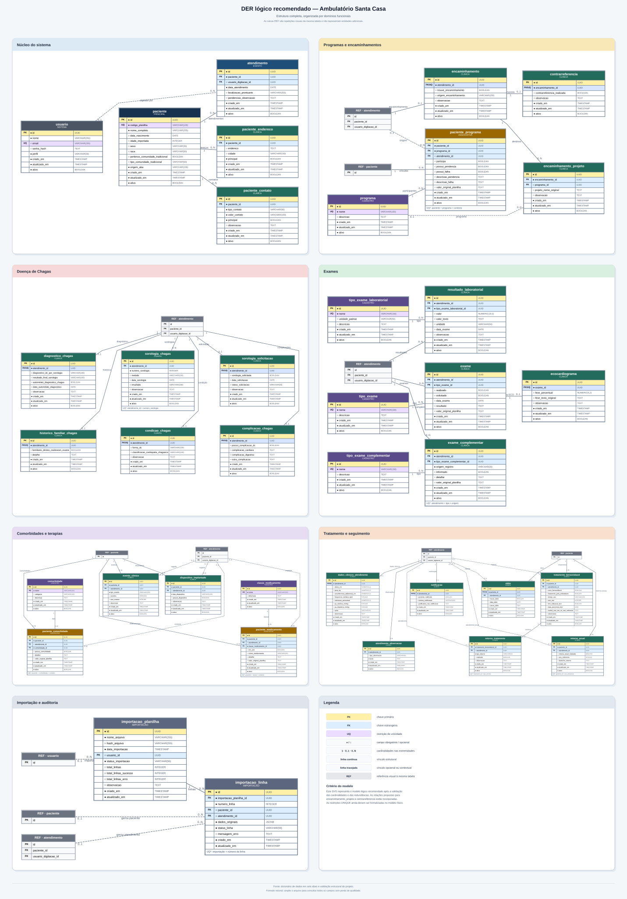

# Descrição do DER — planejamento original

> Documento histórico, movido de `planejamento/DER Definitivo.md` em 2026-10-23.
> Propostas e comandos abaixo descrevem a origem e não o estado vigente.
> Consulte o [índice atual](../../README.md) e o
> [modelo físico](../../MODELO_FISICO_ATUAL.md) antes de implementar.

O DER organiza o sistema do ambulatório em módulos relacionados. As entidades centrais são `paciente` e `atendimento`: um paciente pode possuir vários atendimentos, enquanto cada atendimento pertence a um único paciente.

A partir dessas entidades, o modelo se divide em áreas como dados pessoais e contato, informações clínicas, exames, programas de pesquisa, encaminhamentos, comorbidades, medicamentos, tratamento, seguimento e auditoria de importações.

As relações principais seguem estas regras:

- Relações **1:N** representam situações em que um registro pode possuir vários registros relacionados, como paciente e atendimentos, atendimento e exames, ou paciente e medicamentos.
- Relações **1:1** representam extensões específicas de uma entidade, como um atendimento e seus dados clínicos, ou um exame e seu ecocardiograma detalhado.
- Relações **N:N** são resolvidas por tabelas associativas. Por exemplo, um paciente pode participar de vários programas, e um programa pode possuir vários pacientes. A tabela `paciente_programa` registra essa associação.

As tabelas associativas também podem armazenar informações próprias da relação, como datas de entrada, situação, observações ou origem do vínculo.

No diagrama organizado, as tabelas centrais aparecem algumas vezes como referências visuais para evitar linhas muito longas e cruzamentos. Essas referências não representam tabelas duplicadas no banco.

O modelo procura evitar repetição de dados. Informações do paciente ficam vinculadas ao paciente, enquanto dados que podem mudar a cada consulta ficam ligados ao atendimento. Exames e tratamentos também são registrados separadamente, permitindo histórico completo ao longo do tempo.

Em resumo, o DER apresenta como os dados da planilha serão distribuídos em tabelas normalizadas, preservando o histórico dos pacientes, reduzindo redundâncias e permitindo consultas, relatórios, controle de usuários e futuras funcionalidades do sistema web.

